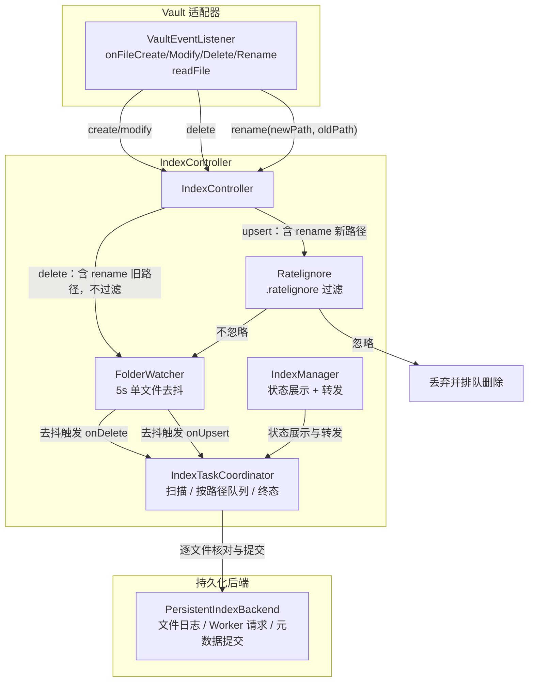
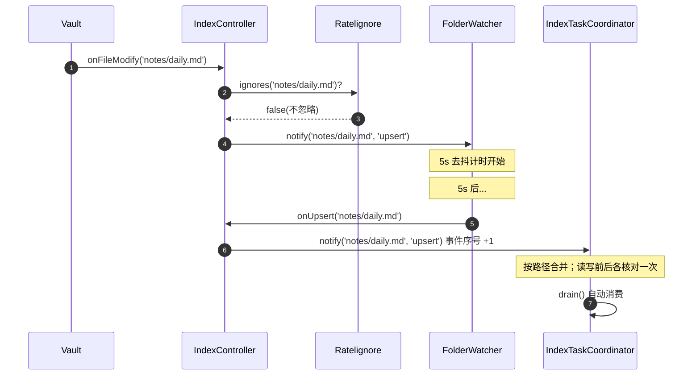
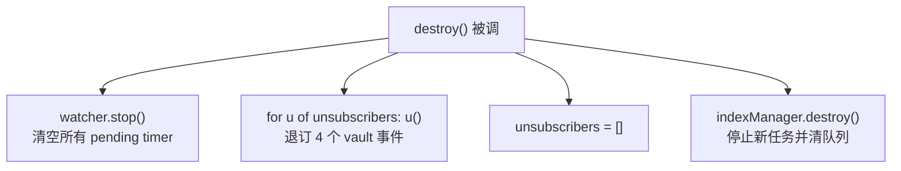

# 索引控制器

> 领域:Host | 聚合 IndexManager + FolderWatcher + Vault 事件 + .ratelignore

---

## 1. 职责

作为索引子系统的"门面控制器",把 Obsidian Vault 事件、文件去抖、`.ratelignore` 过滤、IndexManager 队列消费四个环节粘合起来,对外暴露 `pause` / `resume` / `reindex` 三个操作。

**不做的事**:
- 不负责状态机与队列逻辑(属于 `IndexManager`)
- 不负责扫描、队列合并与逐文件新鲜度(属于 `IndexTaskCoordinator`)
- 不负责去抖计时(属于 [folder-watcher](folder-watcher.md))
- 不负责索引快照与元数据提交(属于 `PersistentIndexBackend`，通过 [Worker 协议](worker-protocol.md)调用处理器)
- 不负责 `.ratelignore` 语法解析(属于 `utils/ratelignore-parser`)

---

## 2. 设计原则

### 2.1 单一入口

**决策**：`main.ts` 装配 `IndexController` 和 `PersistentIndexBackend`。Controller 负责事件和状态协调，Backend 负责文件快照、差异更新及清单／构建戳提交；共享索引访问由 WorkerManager 保护。

**原因**:
- 隐藏内部协作细节,`main.ts` 代码精简
- 状态机(`indexManager.status$`)通过 `controller.indexManager.status$` 暴露,UI 直接订阅
- 卸载时只需 `controller.destroy()`,内部自动清理 watcher + 退订事件

### 2.2 事件 → 过滤 → 去抖 → 入队

**决策**:Vault 事件先过 `.ratelignore`,再进 FolderWatcher 去抖,去抖触发后读文件内容,最后入队。

**原因**:
- `.ratelignore` 过滤在最前:被排除的文件不占用 watcher 的 pending Map
- 去抖在过滤后:避免短时间内多次 modify 触发多次 readFile
- 读文件在去抖后:文件可能在去抖期间被删,readFile 失败时静默跳过
- 入队带 content:Worker 处理时无需再读文件,减少跨线程通信

### 2.3 rename 拆为 delete + create

**决策**:`onFileRename(newPath, oldPath)` 拆为 `delete(oldPath)` + `upsert(newPath)` 两个独立事件。

**原因**:
- 向量索引不支持"改名"原语,只能 delete + insert
- 拆分后逻辑简单,复用现有 delete / upsert 路径
- `newPath` 仍需过 `.ratelignore`(可能 rename 到被排除目录)

### 2.4 协调器驱动扫描、队列与终态

**决策**：启动扫描、事件队列、逐文件新鲜度与单文件持久提交由 `IndexTaskCoordinator` 统一持有；`IndexController` 只负责事件装配与通道选择，`IndexManager` 只负责状态展示与转发。

**原因**:

- 路径事件在枚举之前先注册监听，事件序号持续单调增长，枚举与监听之间的空隙由扫描结束后的内容 hash 核对补齐
- 队列按路径合并，同一路径只保留一个未决项；连续编辑热点路径不会饿死其他文件
- 读取前、推理后、提交前各核对一次内容、事件序号与配置；提交后仍有新事件时保留队列项，只有本次输入 hash 完成才移除
- 终态判据 `canMarkReady` 要求扫描结束、队列与在途均为空、无未结事务、无失败路径，四者同时成立

**只读通道**：`autoIndex=false` 时不装配写路径监听，只订阅事件并记录变更路径集合（`readOnlyChanged()`），不读文件、不嵌入、不取写所有权、不写盘。

### 2.5 装配降级与重试

**决策**：索引运行时装配失败不 reject 插件加载，而是降级：索引不可用、插件其余能力照常，并提供显式重试入口。

**原因**:

- 装配期失败的原因多样（路径归属、迁移、磁盘空间、控制记录损坏），让整个插件不可用代价过大
- 降级时按稳定错误码上屏原因，不显示开发向 message
- 命令面板的「重试索引装配」重建索引运行时；重试成功恢复核对，失败如实报告仍不可用

---

## 3. 组件协作



**只读通道（`autoIndex=false`）**：`RI` 与 `FW` 之后不进入写路径，只把变更路径写入内存集合；不读文件、不嵌入、不取锁、不写盘。

---

## 4. 生命周期

### 4.1 启动期(`onLayoutReady`)

```mermaid
sequenceDiagram
    autonumber
    participant M as main.ts
    participant IC as IndexController
    participant FW as FolderWatcher
    participant V as Vault
    participant TC as IndexTaskCoordinator
    participant J as IndexFileJournal

    M->>IC: onLayoutReady()
    IC->>FW: start({ onUpsert, onDelete })
    IC->>V: onFileCreate/Modify/Delete/Rename → unsubscribe
    opt autoIndex=true
        IC->>IC: wireWriteEvents()（事件订阅先于协调器启动）
        IC->>TC: start() → 逐文件流式扫描与核对
        loop 逐文件串行
            TC->>J: prepare
            TC->>J: commit → 完成记录
        end
        alt canMarkReady 成立
            IC->>IC: status$ → Ready（仅真实全库完成时发 Notice）
        else 有失败路径
            IC->>IC: status$ → Failed（保留可用部分）
        end
    else autoIndex=false
        IC->>IC: wireReadOnlyEvents() + restoreCommittedState()
        Note over IC: 不扫描、不嵌入、不取锁、不写盘
    end
```

**关键路径**：4 个 vault 事件订阅的 unsubscribe 函数存入 `unsubscribers`，`destroy()` 时统一退订。写路径的装配顺序是「先订阅 vault 事件，再启动协调器」，因此枚举与监听之间的空隙由扫描结束后的内容 hash 核对补齐。`autoIndex=false` 时只装配只读事件通道并恢复已提交状态，不执行 legacy 清单迁移、不扫描、不嵌入，新鲜度显示 `unknown`。

### 4.2 运行期(增量事件)



**关键路径**：事件只把「路径 + 操作 + 序号」交给协调器，协调器自行按需读取内容，不在事件里携带正文。扫描期间的变更保留在队列中，等扫描结束后按内容 hash 补齐；同路径后来的事件合并为一项。失败按路径保留并阻止 `ready`，明确恢复后才重试。单文件更新不能让整库标记为 Ready，只有 `canMarkReady` 的四个条件同时成立才算完成。

### 4.3 卸载期(`destroy`)



**关键路径**：Controller 还调用 `indexManager.destroy()`，后续排队任务不再开始。Worker 的清理由 `main.ts` 单独处理；已运行的异步工作不能视为已经取消。

---

## 5. VaultEventListener 接口

`IndexController` 不直接依赖完整 `VaultPort`,只依赖 `VaultEventListener` 子接口:

```typescript
interface VaultEventListener {
    onFileCreate(cb: (path: string) => void): () => void;
    onFileModify(cb: (path: string) => void): () => void;
    onFileDelete(cb: (path: string) => void): () => void;
    onFileRename(cb: (newPath: string, oldPath: string) => void): () => void;
    readFile(path: string): Promise<string>;
}
```

**原因**:接口隔离原则,`IndexController` 只需要事件订阅 + 读文件,不需要写文件 / 列目录 / 读元数据等。

---

## 6. 对外操作与命令语义

| 方法 / 命令 | 透传到 | 说明 |
|---|---|---|
| `pause()` / 「暂停索引」 | `cancelIndexRun()` + `indexManager.pause()` | 先撤销在途调用，再停止调度；文件事件继续入队但不消费 |
| `resume()` / 「恢复索引」 | 必要时 `resetRuntime()` + `indexManager.resume()` | 写操作永久挂起时先重置运行时，再恢复调度；不终止共享 Worker |
| `reindex()` / 「重建当前索引」 | `indexManager.reindex()` | 注入协调器时**不清库**：撤销在途调用后逐文件重新核对；只有未注入协调器才回退清库 |
| 「清理非活动索引代际」 | `dropInactiveGenerations()` | 只删未生效代际，跳过活动 / `building` / `verifying` 代际；没有写所有权时如实拒绝 |
| 「重试索引装配」 | `retryIndexRuntime()` | 降级状态下的恢复入口；重建索引运行时并按结果如实报告 |
| `readOnlyChanged()` | 直接暴露 | `autoIndex=false` 时记录变更路径集合，供只读可见性视图按 `known-stale` 判定 |
| `destroy()` | watcher / manager 停止 + 退订 | 卸载清理 |
| `indexManager.status$` | 直接暴露 | UI 订阅状态（含 `stalled` / `stopping` 阶段与计数明细） |

---

## 7. .ratelignore 过滤

`Ratelignore` 在构造时读取 vault 根目录的 `.ratelignore` 文件,gitignore 兼容语法。

**默认规则**(即使无 `.ratelignore` 文件也生效):

```gitignore
.obsidian/
.trash/
.augmented-canvas/
.obsidian-canvas/
.obsidian-snippets/
```

**降级策略**:文件不存在用默认规则;语法错时回退到默认规则 + `console.warn`,不抛错。

**过滤时机**:仅在 `onFileCreate` / `onFileModify` / `onFileRename(newPath)` 时过滤;`onFileDelete` 不过滤(被忽略的文件若被删,仍需通知索引清理)。

---

## 8. 边界

| 与...的接口 | 方向 | 说明 |
|---|---|---|
| [obsidian-integration](obsidian-integration.md) | 依赖 | `VaultEventListener` 由 `ObsidianVault` 实现 |
| [folder-watcher](folder-watcher.md) | 组合 | 内部持有 `FolderWatcher` 实例 |
| [worker-protocol](worker-protocol.md) | 间接 | 后端通过 `WorkerManager` 请求、取消与独占访问共享索引 |
| [persistence](persistence.md) | 间接 | 后端协调文件日志、向量与代际的成功提交 |

---

## 9. 部分可用与重启复用

成功清单与当前参数兼容时，启动只对内容变化的文件嵌入，未修改文件复用完成记录。当前仍逐文件读取并核对内容 hash；零重复嵌入不代表零磁盘读取。

- **部分可用:** 扫描尚未完成时，已核对并已提交的文件即可检索；未核对文件既不阻止检索、也不被标记为已完成。状态展示区分总文件数 / 已提交数 / 待处理数与当前阶段。
- **失败与中断:** 失败按路径保留，不把整库标成可用；中断后可续：已有完成记录的路径零重复嵌入，未结算事务由日志恢复决策处理。
- **重新核对:** 变更使待处理量增加时提示重新核对，不让旧任务的进度统计污染新任务。
- **不自动清库重试:** 任意运行异常不触发同一会话内的清库重试；需要用户显式执行「重建当前索引」或「重试索引装配」。
- **配置变更:** 会话内嵌入配置变更会被显式拒绝并暂停索引写入，避免新旧参数混写；需要重新加载插件后重建索引。跨会话的配置变化走代际切换（见 [向量索引](../rag/vector-index.md) §6.2）。

## 10. 演进路径

| 阶段 | 能力 | 状态 |
|---|---|---|
| 当前 | 4 事件订阅 + 去抖 + 过滤 + 协调器驱动扫描 / 队列 / 终态 | ✅ 已实现 |
| 当前 | 只读通道（`autoIndex=false` 零写入）与装配降级重试 | ✅ 已实现 |
| 后续 | 批量入队(同目录多文件合并处理) | 待规划 |
| 远期 | 智能过滤(按文件大小 / 修改频率) | 远期 |
