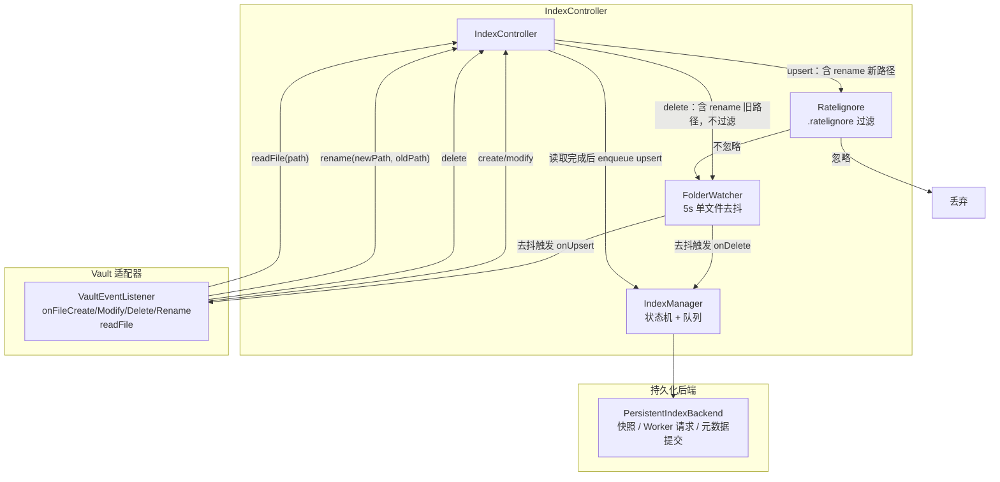
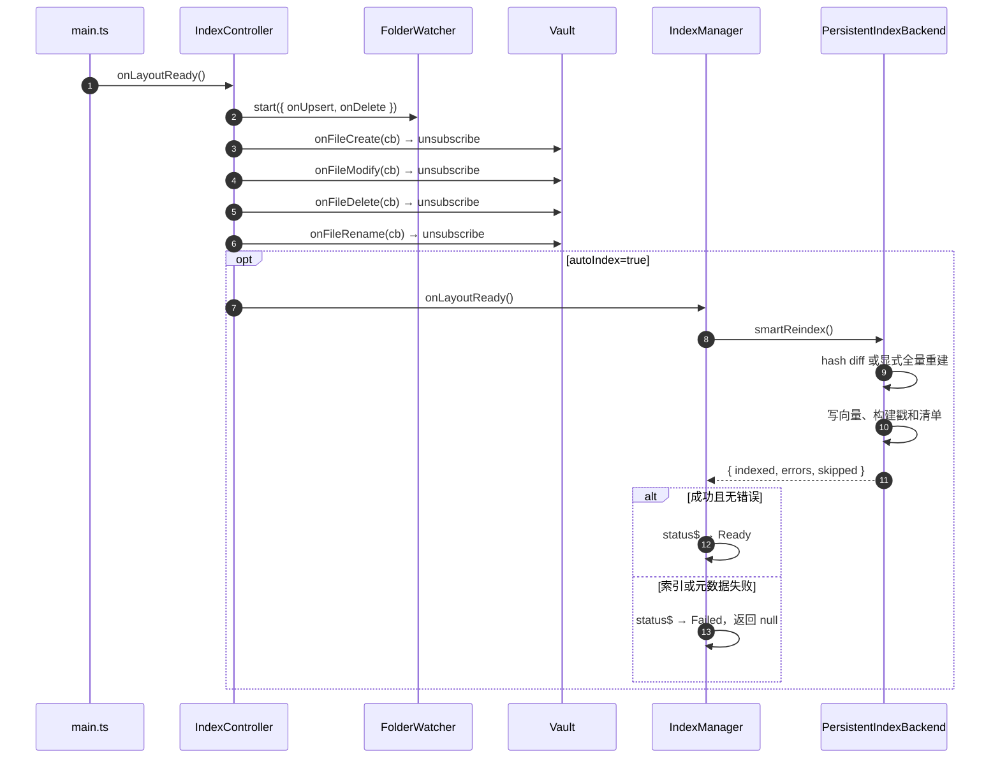
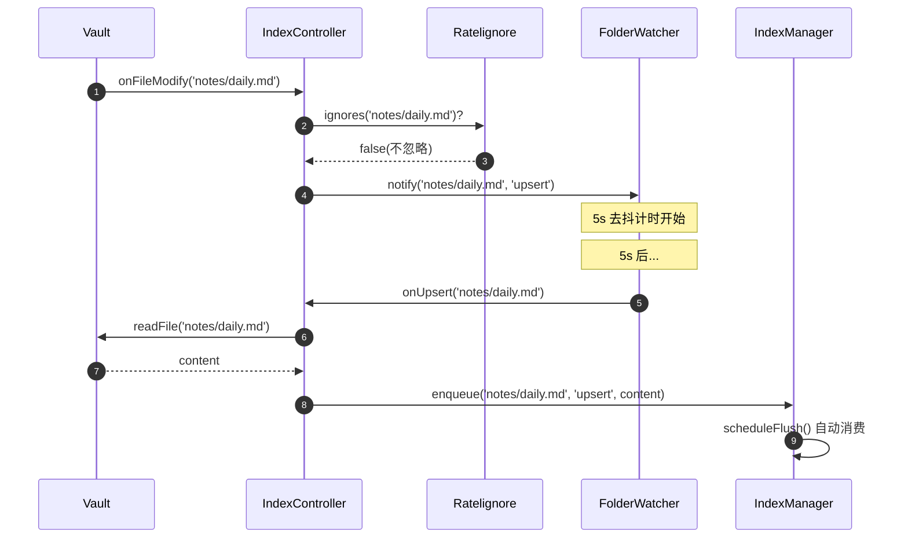
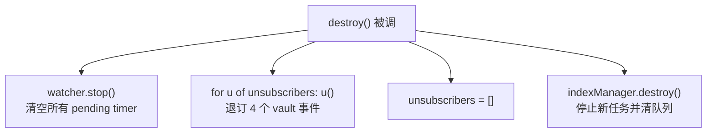

# 索引控制器

> 领域:Host | 聚合 IndexManager + FolderWatcher + Vault 事件 + .ratelignore

---

## 1. 职责

作为索引子系统的"门面控制器",把 Obsidian Vault 事件、文件去抖、`.ratelignore` 过滤、IndexManager 队列消费四个环节粘合起来,对外暴露 `pause` / `resume` / `reindex` 三个操作。

**不做的事**:
- 不负责状态机与队列逻辑(属于 `IndexManager`)
- 不负责去抖计时(属于 [folder-watcher](folder-watcher.md))
- 不负责索引快照与元数据提交(属于 `PersistentIndexBackend`，通过 [Worker 协议](worker-protocol.md)调用处理器)
- 不负责 `.ratelignore` 语法解析(属于 `utils/ratelignore-parser`)

---

## 2. 设计原则

### 2.1 单一入口

**决策**：`main.ts` 装配 `IndexController` 和 `PersistentIndexBackend`。Controller 负责事件和状态协调，Backend 负责文件快照、差异更新及清单／构建戳提交；共享索引访问由 WorkerManager 保护。

**原因**:
- 隐藏内部协作细节,`main.ts` 代码精简
- 状态机(`indexManager.status$`)通过 `controller.indexManager.status$` 暴露,UI 直接订阅
- 卸载时只需 `controller.destroy()`,内部自动清理 watcher + 退订事件

### 2.2 事件 → 过滤 → 去抖 → 入队

**决策**:Vault 事件先过 `.ratelignore`,再进 FolderWatcher 去抖,去抖触发后读文件内容,最后入队。

**原因**:
- `.ratelignore` 过滤在最前:被排除的文件不占用 watcher 的 pending Map
- 去抖在过滤后:避免短时间内多次 modify 触发多次 readFile
- 读文件在去抖后:文件可能在去抖期间被删,readFile 失败时静默跳过
- 入队带 content:Worker 处理时无需再读文件,减少跨线程通信

### 2.3 rename 拆为 delete + create

**决策**:`onFileRename(newPath, oldPath)` 拆为 `delete(oldPath)` + `upsert(newPath)` 两个独立事件。

**原因**:
- 向量索引不支持"改名"原语,只能 delete + insert
- 拆分后逻辑简单,复用现有 delete / upsert 路径
- `newPath` 仍需过 `.ratelignore`(可能 rename 到被排除目录)

---

## 3. 组件协作



---

## 4. 生命周期

### 4.1 启动期(`onLayoutReady`)



**关键路径**：4 个 vault 事件订阅的 unsubscribe 函数存入 `unsubscribers`，`destroy()` 时统一退订。`autoIndex=false` 时启动监听，并只读校验已提交的索引、清单和构建戳：兼容有效时恢复 Ready，否则保持 Idle；不扫描、不嵌入，也不通知全量索引完成。重复的进行中扫描复用同一 Promise；扫描、重建和增量消费串行执行。

### 4.2 运行期(增量事件)



**关键路径**：`onUpsert` 异步读取内容，读取失败时跳过可能已删除的文件。扫描期间的变更保留在 Map 队列中，等扫描成功后消费；同路径后来的事件替换早先事件。失败停止消费并保留事件，明确恢复后才重试。缺少完整清单时，单文件更新不能把全库标记为 Ready。

### 4.3 卸载期(`destroy`)



**关键路径**：Controller 还调用 `indexManager.destroy()`，后续排队任务不再开始。Worker 的清理由 `main.ts` 单独处理；已运行的异步工作不能视为已经取消。

---

## 5. VaultEventListener 接口

`IndexController` 不直接依赖完整 `VaultPort`,只依赖 `VaultEventListener` 子接口:

```typescript
interface VaultEventListener {
    onFileCreate(cb: (path: string) => void): () => void;
    onFileModify(cb: (path: string) => void): () => void;
    onFileDelete(cb: (path: string) => void): () => void;
    onFileRename(cb: (newPath: string, oldPath: string) => void): () => void;
    readFile(path: string): Promise<string>;
}
```

**原因**:接口隔离原则,`IndexController` 只需要事件订阅 + 读文件,不需要写文件 / 列目录 / 读元数据等。

---

## 6. 对外操作

| 方法 | 透传到 | 说明 |
|---|---|---|
| `pause()` | `indexManager.pause()` | 队列继续累积,不消费 |
| `resume()` | `indexManager.resume()` | 明确恢复暂停或失败后的队列消费 |
| `reindex()` | `indexManager.reindex()` | 等待现有操作，清库后全量；保留文件事件；失败向调用方抛出 |
| `destroy()` | watcher / manager 停止 + 退订 | 卸载清理 |
| `indexManager.status$` | 直接暴露 | UI 订阅状态机 |

---

## 7. .ratelignore 过滤

`Ratelignore` 在构造时读取 vault 根目录的 `.ratelignore` 文件,gitignore 兼容语法。

**默认规则**(即使无 `.ratelignore` 文件也生效):

```gitignore
.obsidian/
.trash/
.augmented-canvas/
.obsidian-canvas/
.obsidian-snippets/
```

**降级策略**:文件不存在用默认规则;语法错时回退到默认规则 + `console.warn`,不抛错。

**过滤时机**:仅在 `onFileCreate` / `onFileModify` / `onFileRename(newPath)` 时过滤;`onFileDelete` 不过滤(被忽略的文件若被删,仍需通知索引清理)。

---

## 8. 边界

| 与...的接口 | 方向 | 说明 |
|---|---|---|
| [obsidian-integration](obsidian-integration.md) | 依赖 | `VaultEventListener` 由 `ObsidianVault` 实现 |
| [folder-watcher](folder-watcher.md) | 组合 | 内部持有 `FolderWatcher` 实例 |
| [worker-protocol](worker-protocol.md) | 间接 | `PersistentIndexBackend` 通过 `WorkerManager` 请求及独占访问共享索引 |
| [persistence](persistence.md) | 间接 | Backend 协调向量、清单和构建戳的成功提交 |

---

## 9. 成功与重启复用

Backend 使用实际送入索引的内容快照生成清单，避免把索引期间的新修改误标为已处理。所有写入前撤销成功元数据；向量成功后先保存构建戳，再原子保存清单。失败会向上层传播，并撤销本次成功凭据。

成功清单与当前参数兼容时，启动只对内容变化的文件嵌入，未修改文件跳过。当前仍读取并 hash 文件；零重复嵌入不代表零磁盘读取。缺少有效清单、参数不兼容或上次写入失败时采用保守全量重建；任意运行异常不会触发同一会话内的清库重试。

## 10. 演进路径

| 阶段 | 能力 | 状态 |
|---|---|---|
| 当前 | 4 事件订阅 + 去抖 + 过滤 + 自动消费 | ✅ 已实现 |
| 后续 | 批量入队(同目录多文件合并处理) | 待规划 |
| 远期 | 智能过滤(按文件大小 / 修改频率) | 远期 |
