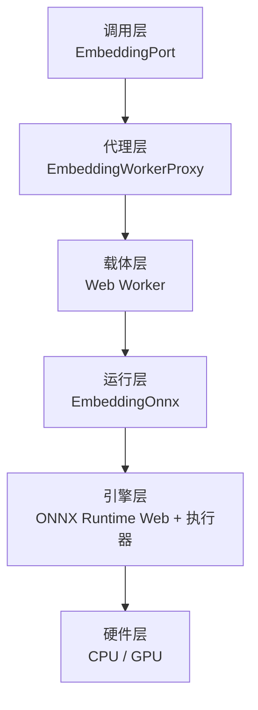

# 嵌入推理的分层执行

> 领域:LLM | 本地嵌入从主线程到 GPU 的完整执行路径
> 相关:[模型管理](model-management.md) 负责选哪个模型,本文负责模型怎么被跑起来

---

## 职责

说明一次文本向量化请求,从 Agent 侧调用到最终落在 CPU 或 GPU 上执行,中间经过哪些层、每层承担什么、失败时如何收敛。

**不做的事**:

- 不负责模型选择与连接配置,见[模型管理](model-management.md)
- 不负责分块与索引落盘,见[向量索引子系统](../rag/vector-index.md)
- 不负责索引线程与查询仲裁,见[Worker 通信协议](../host/worker-protocol.md)

## 分层结构

| 层 | 位置 | 主要职责 |
|---|---|---|
| 调用层 | `src/adapters/embedding-local.ts`、`embedding-api.ts` | 对外暴露统一 `embed()` 接口,屏蔽本地与远端差异 |
| 代理层 | `src/adapters/embedding-worker-proxy.ts` | 请求编址、批次下发、超时、空闲回收、崩溃重建 |
| 载体层 | `src/worker/embedding-worker.ts` | 独立线程承载推理,不接触 Obsidian API |
| 运行层 | `src/adapters/embedding-onnx.ts` | 分词、组装张量、调用会话、池化与归一化 |
| 引擎层 | ONNX Runtime Web | 会话创建、图执行、算子分配、执行器选择 |
| 硬件层 | CPU / GPU | 实际浮点运算 |

## 代理层:主线程只做调度

主线程不执行推理。`EmbeddingWorkerProxy` 持有一个 Worker 实例,把 `embed()` 调用压成消息,再按 `requestId` 回收结果。

| 机制 | 取值 | 作用 |
|---|---|---|
| 单个请求超时 | 120 秒 | 超时即销毁 Worker 并让在途请求失败,避免线程悬挂 |
| 空闲回收 | 5 分钟 | 无挂起请求后终止 Worker,释放 WASM 线性内存 |
| init 连续失败 | 2 次 | 达阈值后标记不可用,不再无意义重建 |
| 单批上限 | 调用方传入(默认 16) | 控制单次消息体量与显存/内存峰值 |

请求超时与 init 失败分开计数:运行时崩溃不计入 init 失败,下次请求仍允许重建;init 反复失败说明环境不满足,继续重试只会拖慢启动。

## 运行层:一次批次做了什么

`EmbeddingOnnx.embedBatch()` 的固定顺序:

1. 逐条分词,保留 `[CLS]` 与 `[SEP]`
2. 取批内最长真实长度,向上对齐到 8 的倍数,夹在 8–512 之间
3. 按该长度构造 `input_ids` / `attention_mask` / `token_type_ids` 三个整型张量
4. 一次 `session.run()` 完成整批推理
5. 用 `attention_mask` 做 mean pooling,再 L2 归一化
6. 返回每条一个单位向量

第 2 步是性能关键。早期实现一律填到 512,短块要按 512 的算力付费;注意力开销随长度平方增长,短笔记因此被显著高估。按真实长度填充对 CPU 与 GPU 路径同样生效。

## 引擎层:两份构建产物

同一个 Worker 源码构建两次,差别只在打包格式与 ORT 入口:

| 产物 | 打包格式 | ORT 入口 | 加载方式 | 用途 |
|---|---|---|---|---|
| `embedding-worker.js` | IIFE | `ort.wasm.bundle.min.mjs` | `new Worker(url)` | CPU 稳定路径 |
| `embedding-worker-gpu.js` | ESM | `ort.webgpu.bundle.min.mjs` | `new Worker(url, { type: 'module' })` | GPU 尝试路径 |

两份都构建期内联进 `main.js`,不额外分发文件。

**为什么必须是 ESM。** ORT 用 `import.meta.url` 拼接胶水模块与 wasm 文件路径。IIFE 打包会抹掉 `import.meta`,路径解析失败,WebGPU 执行器根本不会注册,报错停在 `backend not found` —— 看起来像硬件不支持,实际是打包格式问题。

**为什么两个独立实例。** 在同一个 ORT 实例里,一次 WebGPU 尝试失败会污染 `initWasm()` 状态,连 WASM 回退也一起失败(实测报 `previous call to 'initWasm()' failed`)。因此 GPU 尝试必须跑在一个用完即弃的 Worker 里,失败后换一个全新的 WASM Worker,两者互不影响。

## 引擎层:胶水与运行时必须配对

ORT 分为「胶水模块」(`.mjs`,负责实例化与执行器注册)和「运行时二进制」(`.wasm`,负责算子实现)。两者有多个变体,必须成对使用:

| 变体 | 胶水 | 运行时 | 说明 |
|---|---|---|---|
| CPU | `ort-wasm-simd-threaded` | `ort-wasm-simd-threaded.wasm` | 13 MB |
| WebGPU | `ort-wasm-simd-threaded.asyncify` | `ort-wasm-simd-threaded.asyncify.wasm` | 23 MB |

`ort.webgpu.bundle` 内部固定按 asyncify 变体查找胶水。配错变体时,模块实例上不会挂载 `webgpuInit`,报错为 `webgpuInit is not a function`。

胶水另有一处环境判定会在 Obsidian 的 Blob Worker 里失效:它用 `process.type !== 'renderer'` 判断是否处于 Node,而 Electron 在该 Worker 里给出的是 `worker`,于是执行 `await import("worker_threads")`,浏览器无法解析裸模块名而直接失败。仓库以 vendor 文件固化这份胶水并只改这两处判定,同时用上游文件哈希守住升级。

## 执行器如何选定

启动时按「先探测、再决定」的顺序进行,不做无谓下载:

1. 调用 `requestAdapter()` 判断是否有可用适配器,并排除软件适配器
2. 不可用 → 只准备 CPU 运行时,完全不下载 GPU 那 23 MB
3. 可用 → 只准备 GPU 运行时,暂不下载 CPU 那 13 MB
4. 起一个 GPU Worker 完成 init 与一次预热,量出真实单块耗时
5. 成功 → 该实例直接交给代理层接管,不重建;失败 → 销毁,换全新 WASM Worker,并按需补下 CPU 运行时

第 5 步的「接管」是必要的:探测本身要加载模型并编译 wasm,若成功后丢弃重建,启动会白付一次完整初始化成本。

## 后端切换不重建索引

配置指纹只包含影响向量兼容性的字段:模型标识、模型修订、维度、分块器版本、分块大小与重叠、文本版本。**执行后端不在其中**,模型标识也不编码后端。

因此 WASM 与 WebGPU 之间切换时指纹逐字不变,既有索引直接复用。三条约束由此固定:

- 不把后端写进模型标识
- 不把后端加入指纹字段清单
- 不改变模型与维度

换模型(例如改用更高维度的中文向量模型)属于另一条路线,会强制重建,与本机制无关。

## 精度差异

GPU 与 CPU 的浮点运算顺序不同,同一段文本在两个后端得到的向量存在约 1e-5 量级的数值差异,余弦排序基本不变。索引向量与查询向量可能来自不同后端,这是可接受的设计取舍,不为此强制重建索引。

## 相关文档

- [模型管理](model-management.md) — 模型选择、连接与状态
- [向量索引子系统](../rag/vector-index.md) — 分块、写入与增量同步
- [运行时资产下载](../host/asset-downloads.md) — 模型与引擎的下载、重试与失败处理
- [Worker 通信协议](../host/worker-protocol.md) — 索引线程协议与共享索引占用
