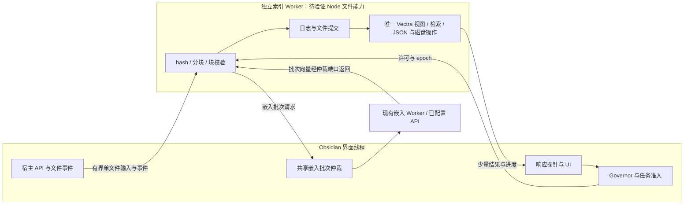

# 索引执行与存储架构设计（提案）

适用对象：负责索引架构与实现的维护者。基线为 1.3.0（`d4d2717`）；本文描述拟议架构，不代表现役实现或验证通过。

用户明确索引时卡顿的是 Obsidian 客户端。本设计先解决执行隔离、数据与写所有权、查询及恢复，再讨论自适应速度。技术设计由 Agent 自审裁定；Worker 平台能力与性能必须经过真实环境验证。

关联需求：`BUG-1-INDEX-PERF-001`，见[需求正文](../../prd/adaptive-indexing.md)。本次改造范围与验收另见 [S-ADAPTIVE-INDEX](../../superpowers/specs/2026-11-02-adaptive-indexing.md)，实施计划见 [P-ADAPTIVE-INDEX](../../superpowers/plans/2026-11-02-adaptive-indexing.md)，状态 Pending。

## 背景与设计决定

1.3.0 支持文件级提交与中断续建，但 `IndexTaskCoordinator.runDrainLoop()` 持续消费文件，`EmbeddingOnnx.embed()` 连续推理批次，尚未形成资源反馈控制。嵌入计算在 Web Worker 中且 ONNX 已设单线程，不代表 CPU 无持续占用。

`ChunkingCoordinatorProcessor.prepareBlocks()` 仍在主线程分块并提交整篇的嵌入请求，准备结果驻留至文件提交。`VectraStore.replaceFile()` 经 `endUpdate()` 调用 JsonCodec，在主线程序列化整份索引，再由原子文件存储保存。逐文件可靠提交没有消除整库 JSON 的写放大。此前性能测试中的假嵌入不能证明真实 ONNX 的交互体验；本次短时原生采样也不足以精确划分各环节占比。

采用两个独立工作方向：**A：可测信号驱动的低打扰调度**；**B：存储计算与界面线程隔离的可行性验证**。A 可降低持续占用，无法消除一次同步 JSON 序列化；B 可以隔离界面阻塞，但不自动减少磁盘写入量。两项分别验收，不把其中一项完成当作全部性能问题解决。

用户随后明确卡的是 Obsidian 客户端，当前设计优先级调整为 **先 B 的独立线程可行性与界面隔离，再 A 的自适应调度**；保留 A/B 标识方便追溯，不代表执行先后。以 UI 响应为首要验收对象，不能用降低平均 CPU 代替消除客户端长阻塞。该调整是设计决定，不代表已实测确认某一函数占全部卡顿时间。

## 目标与非目标

- 环境忙时迅速降速，稳定后缓慢恢复；未获取硬件信息时仍能保守工作。
- 限速落到扫描、单文件准备的内部批次、文件间调度及提交准入，覆盖大文件。
- 查询优先使用共享模型资源，单个文件不能永久占据模型队列。
- 保持单写入者、prepared 日志、receipt、revision、代际与取消 epoch 契约。
- 将调度等待、运行停滞、用户暂停和真实失败分开显示及计时。

不承诺整机 CPU 百分比、温度控制或固定完成时长；不新增原生模块、提权采集、远端调用或自动换模型。不在本提案内更换 Vectra、引入分片数据库或合并多个文件后才保存完成记录。现役架构说明与本提案分开维护，本提案不代表当前实现。

## 索引总体设计

### 数据流与唯一所有权

索引是从 Vault 文件版本到可检索派生数据的完整系统。宿主侧枚举路径、接收变更并按需读取内容；索引线程核对内容 hash 和配置指纹、分块、请求嵌入、准备事务、提交向量及完成记录；查询侧只读取允许消费的完整版本。界面线程不能继续承担独立的一套分块、校验或向量存储旁路。

以索引根为写所有权边界，包含代际、日志、完成记录和回收。宿主的生命周期协调器持有进程级 owner 租约与 epoch，并把受约束的存储执行权交给唯一索引线程；Worker 不自行创建第二份不关联宿主的 owner。消息包含 runtimeId、generationId、epoch、requestId，旧线程结果不能通过新实例的验收。存储线程崩溃后先结束旧运行时并按日志恢复，再开放新 owner 的查询和提交。

每个代际只保留一份权威 Vectra 视图，界面通过异步端口访问；不暴露全库条目数组给 UI。模型线程仍保持单独职责，索引批次通过共享仲裁器调用，不在索引线程再次加载第二份 ONNX 模型。

宿主 lease、owner 类实例和 `beginCommit` 函数不可通过 structured clone 传输。宿主持有唯一 OS 锁和 lease，只向 Worker 传递可序列化 grant（runtimeId、epoch、受限根目录、generationId、访问模式）；Worker 以本地执行权适配器检查 grant 和 revoked 状态。每次存储提交通过独立控制通道向宿主申请提交 ticket，宿主登记后授予，Worker 完成 receipt/IO 后结算；ticket 未结算时 lease 不得转交。不得在 Worker 另建独立磁盘 owner 锁，也不得把未结算 ticket 当成 UI 超时后可以删除的请求。

Vault 代理仅返回单文件正文、stat 和事件序号；hash、分块、配置核验在 Worker 内完成，不能藏在主线程的 readSnapshot helper 中。宿主仍有路径权限与事件订阅边界，但不通过代理执行索引重计算。

交接协议必须阻止旧写入，而非只拒收旧结果：宿主发出 revoke 后，Worker 在所有 mutation 准入处拒绝旧 epoch 的新写，停止新准备，安全收尾已开始的原子提交，完成后返回带 runtimeId/epoch 的 `revoked-and-drained` ACK。宿主取得 ACK，或确认旧运行时退出且存储操作已终止后，才释放/转交 owner 并开始日志恢复。仅消息超时、取消信号、旧结果被忽略，都不足以启动新写线程；无法确认时保留占用并报告正在停止。

### 存储、恢复与配置

沿用 1.3.0 的代际、prepared、分片、receipt、revision 和块集合 hash，保留既有目录与兼容验证规则。将存储移到线程不构成内容配置变化，不因线程实现版本变化触发重新嵌入；只有数据格式、模型或分块配置确实不兼容时才迁移或重算受影响文件。

原子提交仍为「prepared 已持久化 → 完整替换目标文件块 → receipt 持久化 → 清理已结算日志」。UI 只在 receipt 可靠保存后计完成，不以 Worker 收到请求、推理结束或消息返回代替持久提交。删除、同路径重建、文件变短/变空和索引期间的再次修改继续由内容版本与 revision 核对，不因消息排队改变语义。

独立线程隔离执行位置，不能改变 Vectra 每次保存全库 JSON 的复杂度。当前决定是先保持存储格式验证隔离收益，不同时引入数据库迁移。如果同样的写放大仍导致 I/O/内存不可接受，再以实测为依据比较分片或增量存储，并单独形成架构决策；不可默认把线程隔离称作存储扩展性已经解决。

### 查询、背压与故障

查询与提交由索引线程内统一队列协调：持久提交不可被中途打断，提交边界优先服务交互查询，禁止让一个全库构建请求占据整个队列直到全部文件结束。推理准备期间不持有 Vectra 存储临界区，因此可继续检索已有完整文件。

所有消息有界，输入按单文件/批次、输出按进度增量或 topK 结果传递；对正文、向量、待请求数量和累计字节分别设背压，不能只限制消息条数。取消、关闭和错误必须结算对应 pending；Worker 返回 malformed 数据、失联或退出时按失败处理，不静默回到主线程执行重计算。

取消、撤销、关闭和 drain ACK 走独立的控制消息通道，不等待数据队列的预算许可。数据请求从入队至结算持续计入在途字节，发出 postMessage 不等于已释放内存；取消清理尚未开始的数据工作并结算对应等待者。控制通道可以及时送达，但不能抢占同步 JSON/当前原子提交；实际生效必须以 ACK 和存储终态为准。

调用方 Promise 的取消/超时与底层释放数据的终态分别记账；已发出载荷直到真实终态、确认释放的取消 ACK 或运行时终止回收才归还数据 credit。顶层索引请求与反向 Vault/Embedding 依赖请求使用独立有界预算，依赖响应不能等待父请求释放配额，否则会形成双向 RPC 自锁。嵌套日志清理/恢复复用同一远端 mutation ticket，最外层与子 I/O 全部结束才结算，不能由内层 settle 提前释放写所有权。

Node/文件能力尚需真实 Obsidian 验证。若平台不支持预期 Worker 形态，设计回到运行时方案选择，保留暂停与保守限速作为临时缓解，不以模拟 Worker 交付。只验证 Node 测试进程成功不能证明 Obsidian 中可运行。

`autoIndex=false` 使用独立的 read-only 初始化模式：不申请写 owner，不 createIndex、不恢复/迁移/修写、不自动扫描全库，也不启动索引或压力探针。仅采用可信已提交版本，对候选执行存在性/黑名单校验并标记新鲜度未知；未决或无法验证的路径过滤。用户显式搜索所需的查询嵌入仍可调用已配置模型，不等同于自动索引。由只读切换到写模式时先关闭旧存储实例，经 owner/grant 流程启动写运行时，禁止两个模式并存访问同一份可变视图。

### 验证顺序与交付判断

1. 先验证真实 Obsidian 的线程创建、打包和文件能力，并以合成大索引测量界面输入/滚动与大提交响应。
2. 再证明唯一存储视图、查询/提交仲裁、取消交接、崩溃恢复和现有检查点复用。
3. 最后完善自动调速、用户模式和压力反馈，并验证大文件批次与真实 ONNX 的资源表现。

以响应延迟、最长界面阻塞、消息复制字节、峰值 RSS、累计磁盘写量与索引吞吐共同裁定。前三项只做到了其中部分时，不标记客户端卡顿已经解决；平台能力或故障恢复没有证据时，不进入正式替换。

## 模块与运行边界

| 新模块 | 职责与边界 |
| --- | --- |
| `IndexRuntimeProbe` | 宿主适配层汇总响应延迟、近期交互、可见性及能力信息；不采集键入内容、笔记路径或正文 |
| `IndexResourceGovernor` | 纯状态机，输入有效样本，输出准入时间、批次/并发上限和降速原因；不访问 DOM、模型或磁盘 |
| `EmbeddingWorkScheduler` | 主线程统一仲裁同一模型实例的交互/索引批次，最多一个真实推理批次在途；不持有索引写锁 |
| `IndexBudgetGate` | 可取消的准入等待与耗时上报，接入协调器和日志提交入口；等待期间不占有存储临界区 |
| `IndexPerformanceSnapshot` | 只读发布速度模式、档位、原因、等待期限和阶段耗时；日志仅保留本地聚合指标 |

这些是拟新增职责，文件名由后续 plan 固定。`main.ts` 只装配和清理，Governor 可用可控时钟独立测试。共享调度器按模型运行时标识管理；未知调用默认交互级，只有明确标识的索引工作受后台预算控制。不把产品内 Subagent 或开发期 Worker 当成新机制的实现。

## 信号、有效性与降级

### 响应信号

前台时用单调时钟测量 250 ms 定时器的超额延迟，取最近 5 秒窗口的有效样本分位数。窗口隐藏、系统恢复后的首次长间隔、窗口迁移和探针停止产生的样本一律标记无效；恢复前台先积累新样本，不继承休眠前的「空闲」。探针只在索引任务活跃期间工作，卸载清理计时器及监听器。

只有独立可见性事件、明确的探针重启或宿主可用的恢复事件，才能将采样中断分类为暂停。不能仅因 timer 延迟很长就把它当成休眠丢弃；没有独立证据的前台长延迟必须记为压力，避免把真正的大 JSON 卡顿从指标中删除。无法区分系统暂停时宁可暂时保守降速，不永久报失败。

捕获可信的 input/keydown/pointer 交互事件，只记录最近活动时间，不记录按键、文本、坐标或目标内容；切换笔记通过宿主适配层传递时间信号。`requestAnimationFrame` 与 Long Tasks API 仅在可用时作辅助，不把隐藏窗口缺少帧解释成高负载，也不将缺少事件解释成空闲。

### 工作与内存信号

嵌入适配器分别上报真实批次的执行耗时、文本数和估算 token 数；排队等待不计入推理耗时。提交端分别记录向量枚举、校验、序列化/写入、flush 和总耗时，不能拿总 I/O 等待冒充 CPU 使用率。阶段无法细分时保留 unknown，不伪造精确占比。

逻辑核数可影响冷启动上限，但本轮不增加 ONNX 线程数。浏览器暴露的设备内存、JS heap 或宿主受支持的进程内存信息均为可选提示；JS heap 不含完整 WASM 与外部内存，RSS 也不等于整机内存压力，不能仅凭其中一个绝对数自动判定系统将耗尽内存。最低保证使用自有暂存字节数、队列规模和运行失败信号；不可用的信息标记 unknown。

没有有效响应样本时维持保守档；窗口后台运行最多保守档，不能因用户未操作本窗口而满速消耗其电脑。内存信号显示风险或自有预算达到上限时停止启动新的索引准备，已进入的提交安全收尾；等待是可见、可取消的，不能靠清库或丢 receipt 释放资源。

## 自适应策略

### 档位与反馈

以下为初始设计参数，需在真实 ONNX 与 Sandbox 验证后由工程审查调整，不能称为已测最优值。档位仅影响调度，不改变模型、分块结果或配置指纹。

| 档位 | 索引目标工作占空比 | 单批文本数上限 | 扫描并发上限 |
| --- | --- | --- | --- |
| 保守 | 15% | 2 | 1 |
| 温和 | 30% | 4 | 1 |
| 均衡 | 50% | 8 | 2 |
| 加速 | 75% | 16 | 4 |

占空比是「索引工作耗时 / 工作与休息耗时」的调度目标，不是 CPU 百分比。每个索引量子完成后估算 `rest = workMs × (1-duty)/duty`，单次休息上限 2 秒；未偿还休息作为有上限的预算债务保留，禁止通过每次截断把长任务实际变成满速。I/O 等待可能使估算偏保守，后续只根据真实响应和工作测量校准，不声称获得了 CPU 占用。

由工作调度器唯一记账：实际执行的扫描读取/核对、分块步骤、单次模型批次、分片写入以及完整提交分别计为互不重叠的量子。文件任务与 `prepareBlocks` 的父级总耗时只用于诊断，不再记债；排队、Gate 休息和交互请求耗时也不记为索引工作。一个量子包含内部 flush/校验时只记该量子总耗时，不再对子步骤重复计费。所有 Gate 共用一份债务账本，不为每个接入点独立累计。

债务最多保留 30 秒，并以不超过 2 秒的可取消等待片段偿还。超过上限说明出现不可控长量子，进入 `oversized-quantum` 保护状态：停止发放新索引许可，已开始提交安全收尾，向诊断暴露长阻塞，不能简单截断债务继续满速。自动恢复仅在债务清偿且连续有效稳定窗口满足降压条件后发生，重新从保守档开始；手动暂停仍不会自动恢复。

首个档位为保守。前台有效样本窗口 p95 超额延迟超过 80 ms，或近期有用户交互/交互请求等待，则立即降一档并延后新索引批次；单次延迟超过 200 ms 或连续两个窗口超限，直接回保守。连续三个有效窗口 p95 小于 20 ms、最近 2 秒无交互、无资源预算风险且没有待服务交互请求时才升一档，每次升级间隔至少 15 秒。20～80 ms 区间保持原档，避免振荡。

交互暂缓以 2 秒为窗口，持续交互时可反复延期；不保证人在持续高负载操作时索引仍有固定吞吐。环境已稳定且只是交互队列持续繁忙时，通过模型仲裁提供有限进展，不用一项永久 pending 的查询将索引永远饿死。用户手动暂停优先于一切自动规则，不能自动恢复。

### 批次内部与共享模型

索引入口需显式携带 workload 与可取消预算上下文。拆分发生在单篇文件的真实模型批次边界，不能在整个 `embed(allChunks)` 返回后才休息。外层仍按文件准备完整一致的向量集合，并沿用原有日志提交；休息不能让半篇向量被搜索采用。

由主线程的 `EmbeddingWorkScheduler` 为每批发放许可，一批一个请求，Worker 收到该批后仅执行一次推理并返回；现有 Worker 内连续多批循环不得继续绕过外部仲裁。动态批次同时受文本数、估算 token 数及上一批执行时间限制；调整目标是让后续批次接近 150 ms 量级，而非承诺单次调用可抢占。若一条文本本身已很慢，只能降至单条并增加休息，不能为了性能截断正文或改变分块结果。

交互请求可以越过尚未获许可的索引批次；正在执行的 ONNX 批次不可抢占，等该批结束后切换。最多连续服务 3 个交互批次后，若无用户交互保护/资源暂停且有索引等待，允许一个最小索引批次；每个请求独立取消，取消索引不得终止共享 Worker 中的查询。API 嵌入只拆批和调度已配置的原端点，不增加并发请求、不改变供应商限流/重试语义、不自动切到远端模型。

优先级固定为：用户暂停/取消与资源硬保护 → 真实输入保护 → 公平仲裁 → 常规占空预算。只有「查询持续排队」但没有近期真实输入、响应压力和内存风险时，公平仲裁可越过查询排队引起的普通暂缓；它不能绕过预算债务或资源硬保护。服务索引后交互批次计数归零，已取消或仅排队的请求不计为已服务批次。

### 扫描、准备和提交

扫描并发只能在表中范围内调整；内容 hash/路径核对的正确性不减少。文件之间、批次之间以及新的 prepared 准备前都经过 Gate。单文件暂存超预算则停止预取，不并发准备第二篇；现有分块器一次同步处理大文件的限制必须测量，后续可引入保持相同输出的分段执行，不能用多次 `await Promise.resolve()` 冒充给渲染事件循环让步。

暂存不能仅靠「等待内存下降」恢复：A 阶段需将单文件批次结果及时写入其事务分片，未完成全部分片前不发布 prepared，也不替换旧向量。取消时保留旧文件完成记录，未形成 prepared 的部分仍按既有规则清理，不能宣称支持半文件推理跨重启续算。该调整涉及处理器的批次产出端口与 journal 的流式准备入口，不能继续先积累整篇向量再分批写盘。

自有准备缓冲的初始软/硬预算为 32/64 MiB，按实际持有的向量缓冲与序列化分片字节累计，控制对象为本模块缓冲而非整个进程 RSS。软阈值停止预取并落分片后继续；硬阈值停止分配，安全取消尚未提交的准备、回收缓冲，将该文件标记资源受限而非自动循环重试。其他文件仍可推进，整库不报 ready。当前 Vectra 提交需要重组完整文件向量时，先检查预计字节；超过同一预算的文件不尝试通过永久等待解锁，保留旧索引并明确受限，待流式存储能力或用户显式重试后处理。此限制必须在大文件验收中记录，不能用静默跳过制造完成。

在 `owner.beginCommit()` 或存储互斥开始前等待提交许可。已进入的日志/向量/receipt 原子操作连续完成，不在持锁期间人为 sleep，不合并多个文件的成功凭据，不为降占用取消 fsync。大提交耗时反馈为存储瓶颈，A 阶段只能延后下一次提交，不能承诺缩短这一次同步序列化。

## 等待、停滞与生命周期

Governor 的等待必须携带任务 ID、epoch、原因、准入期限与 AbortSignal。等待时没有「真实完成」活动，因此不递增完成数、不发送伪批次活动。索引看护显式区分 `waiting-budget` 和 `running`：预算等待从无进展计算中扣除，等待有自身期限；真正的模型/磁盘执行仍由实际阶段 watchdog 监测，不能用任意等待标记无限掩盖卡死。

每个已发放许可只能启动一个量子；不把许可长期缓存在 Worker。取消/暂停/epoch 变更撤销未使用许可，立即解除等待，不计为文件处理失败；迟到结果继续按现有 epoch 和内容版本校验处理。用户暂停保持原暂停状态；自动资源等待显示为「为保持流畅正在降速/等待」，与模型失败、无进展停滞分开。

系统恢复或可见性改变时清空过期速度样本，回到保守重新积累；不补跑睡眠期间欠下的批次。重启只保存用户选择的模式，实时档位和预算债务不落入配置指纹、不跨进程恢复。`autoIndex=false` 不创建索引探针、不发起自动索引的模型请求、不修写检查点；用户显式查询所需的嵌入不受此限制。没有索引任务时不常驻高频探针。

## 优先落地的独立索引线程与验证门槛

优先验证专用、具备 Node 文件能力的索引 Worker，使其承担内容 hash、分块、块校验，独占一个代际的 Vectra 实例、索引视图、JSON 序列化和持久提交。主线程只保留必须调用 Obsidian 的端口、Vault 事件、Governor、轻量查询/索引准入和 UI；不在主线程与 Worker 各保存一份完整 Vectra 副本。Embedding Web Worker 继续负责模型，不向它加入 Node/HTTP。

现有 `InlineWorker` 是同一主线程内的异步调度，不具备线程隔离效果；把方法加上 async、setTimeout 或更换名称不能满足 B。B 的成功条件是实际运行在独立 Worker，并在索引和大提交时验证界面响应。宿主 API 无法移到 Worker 的文件读取仍经异步端口完成，按单文件/有界批次传输，禁止一次发送全库正文；索引 Worker 不导入 Obsidian。

这不是把 `JSON.stringify()` 单独丢给 Worker：若每次把整个索引 structured clone 过去，仍有整库复制和双份内存成本。迁移时需将 Vectra、完整枚举、检索和日志涉及的存储操作统一放到唯一存储 owner 一侧，消息只携带单篇/批次的必要数据，向量尽量使用可转移的 TypedArray 缓冲区；禁止转移后继续读取已 detached 的源缓冲区。

正式采用前需在真实 Obsidian 验证 Node Worker 创建/打包/CSP、公开 Vectra 接口、路径限制、同代际单写入者、崩溃恢复、取消交接及内存峰值。不得复用拥有其他权限的 Skill 脚本沙箱。所有索引读取/写入仍经过统一端口；主线程先有存储实例、再增添第二个 Worker 实例的过渡方式不允许上线。

B 阶段仍沿用既有 prepared/receipt 和原子替换，单纯移动 owner 不应强制重新嵌入。若 Worker 能力无法可靠落地，保留 A 的限速能力并明确 B 未完成；不得悄悄降级为主线程全速写入。降低整库写放大需要独立的分片/增量存储设计及兼容验证，不在本稿将它写成已选择的数据库改造。

先以合成数据在 Sandbox 验证真实 Worker 创建、hash/分块/大 JSON 提交时的输入与滚动响应，再验证退出/崩溃交接。先取得 `revoked-and-drained` ACK，或确认旧运行时退出且存储操作终止，再转交 owner 并按既有日志恢复；取消消息或主线程等待超时本身不算已停止。单存储线程内部还需在文件事务边界优先处理查询，避免把 UI 卡顿转成全部检索长期排队。

## 模式、兼容与影响面

默认模式为自适应。低占用固定保守上限但保留交互保护；全速关闭常规占空休息，仍保留单批上限、单写入者、交互公平性与资源硬保护，并提示可能影响电脑流畅度。切换速度模式不重建索引、不改变内容或配置指纹；手动暂停不能被模式切换隐式撤销。

涉及 `index-task-coordinator`、`index-processor-port`、嵌入端口与 Web Worker 协议两端、运行时装配、阶段看护、反馈与中英文设置文案。实际新增设置时加载设置 UI Skill；现役架构文档待实现后同步，不提前把候选 Worker 架构写成事实。

不新增遥测、资源上传或笔记外发；本地诊断仅记录档位、原因、匿名工作数量/字节与阶段耗时，不记录正文、私人路径、端点密钥或机器标识。不能因记录性能而新增自动模型测试请求。

## 验收与设计风险

| 编号 | 场景与证据 | 通过条件 |
| --- | --- | --- |
| A1 | 可控时钟与压力轨迹 | 立即降档、慢升档、迟滞稳定；无有效样本不进入加速 |
| A2 | 单篇超过 200 块的大文件 | 文件内部可降速、查询可在批次边界插入；不等待整篇推理结束 |
| A3 | 取消、暂停、epoch 变化和长预算等待 | 不新增失败、不制造进度；取消及时结算；真实执行卡死仍可被检测 |
| A4 | 模型共享队列与持续交互 | 每运行时最多一批在途，交互优先且满足条件时索引不饿死，索引取消不误杀查询 |
| A5 | 隐藏窗口、系统暂停与信号缺失 | 无虚假高负载/空闲判断，无恢复后补跑洪峰，默认保守 |
| A6 | 新旧检查点和模式切换 | 未变文件零重复嵌入，receipt/块集合一致；模式切换零重建 |
| A7 | 真实 ONNX、512 维、短文库和大文件 | 同机对照全速与自适应，记录响应延迟 p95、最长阻塞、进程 CPU/RSS、磁盘写量和吞吐；至少三次，交互负载一致 |
| A8 | 存储隔离实验 | 无整库跨线程复制、无双写 owner；崩溃后可恢复；前台提交长阻塞明显下降且内存未恶化至不可用 |

另须覆盖：单篇超过自有缓冲预算时不会死等或无限重试；父子 Gate 不重复计债；没有恢复证据的长 timer 延迟计为压力；持续查询条件下公平许可不会被普通排队保护永久覆盖。

A 阶段交付至少要求：有效压力被观测后 1 秒内禁止发放更快档的新许可；无新许可突破批次/并发上限；持续重负载时平均索引吞吐允许下降，但已有完成记录不丢失。真实不可抢占批次或存储提交超过该时间，不计为调度器未响应，但必须单列为阻塞缺陷，不用豁免掩盖用户卡顿。

交互验收以可复现响应轨迹与真实模型对照为准，不能仅看总完成时间或假嵌入测试。全速/自适应都出现的长同步 JSON 阻塞归 B 阶段，未关闭前整体性能条目不能标为全部解决。具体目标值随基线实验写入实施 plan，不能事后只挑有利样本；这里的档位与阈值是待验证设计参数，不是测试结果。

## 设计审查记录

2026-11-02，按索引维护者在实现前判断方案的目标独立审查全文。首轮发现 2 个阻断、2 个影响：大文件超缓冲预算的退出路径、多层 Gate 重复计债、查询排队与公平许可冲突、长延迟被误作休眠过滤。修订后仅复跑原 4 项，剩余 0 阻断、0 影响；主代理裁定架构设计通过。

本轮只完成需求和设计、登记与文档检查。未验证真实 ONNX、Sandbox、存储 Worker 平台能力或性能目标，不能将设计审查通过写成性能改善已经交付。后续 plan 需先验证反馈信号与运行时接缝，再按 A/B 各自边界实施和验收。

同日根据「卡的是 Obsidian 客户端」修正设计优先级：后续先验证 B 的真实独立线程及 UI 响应，迁出 hash、分块、校验和完整存储视图，A 作为资源调度补充；此前复核结论不冒充这次线程实现已经验证。

本次总体设计拆分复核补齐了 owner 撤销/drain/ACK 交接和独立控制通道；已统一旧线程停止确认必须先于 owner 转交与恢复的顺序。未运行任何线程或存储实验。

## 参考

- [索引可靠性设计](../../superpowers/specs/2026-10-31-index-reliability.md)：保留文件提交、恢复和代际边界。
- 当前源码：`src/core/index-task-coordinator.ts`、`src/core/index-processor-port.ts`、`src/core/index-file-journal.ts`、`src/adapters/vector-vectra.ts`、`src/adapters/embedding-onnx.ts`、`src/adapters/embedding-worker-proxy.ts`、`src/worker/embedding-worker.ts`。
