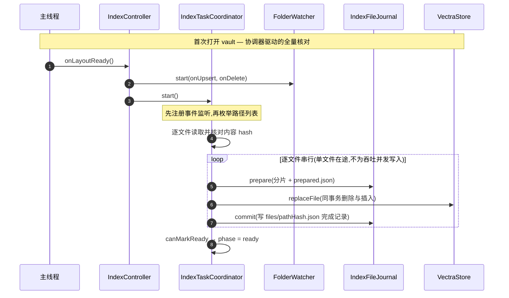
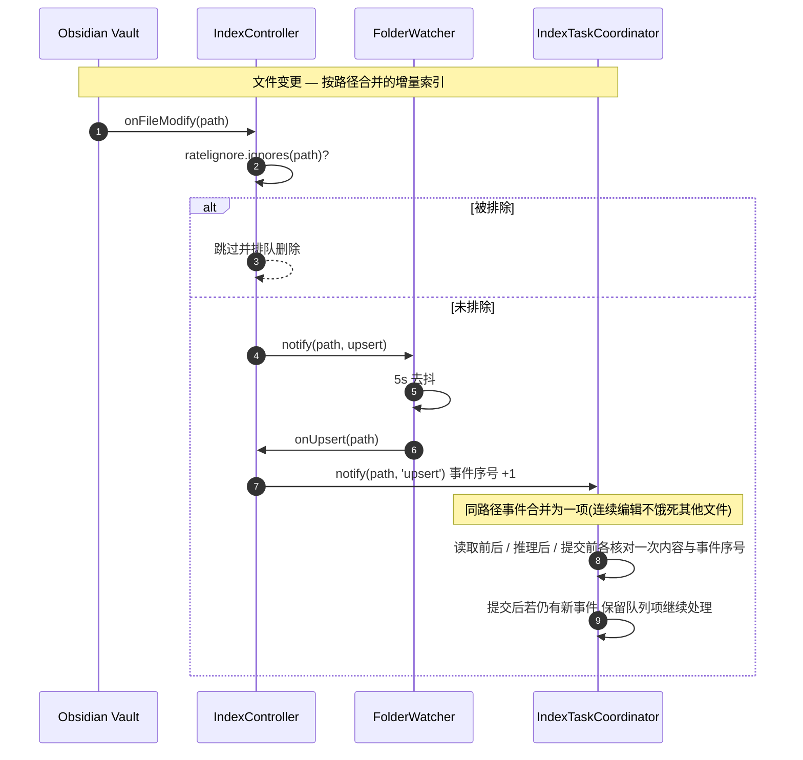
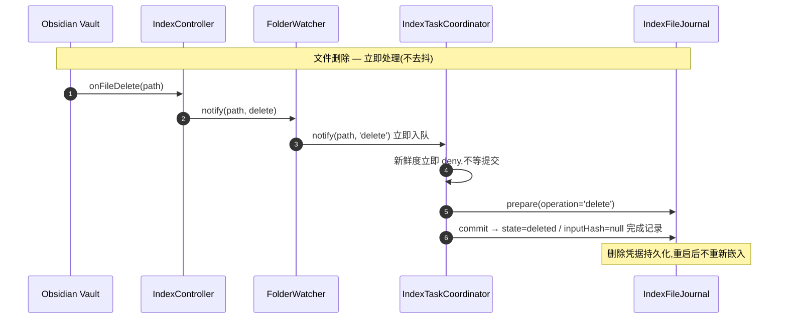
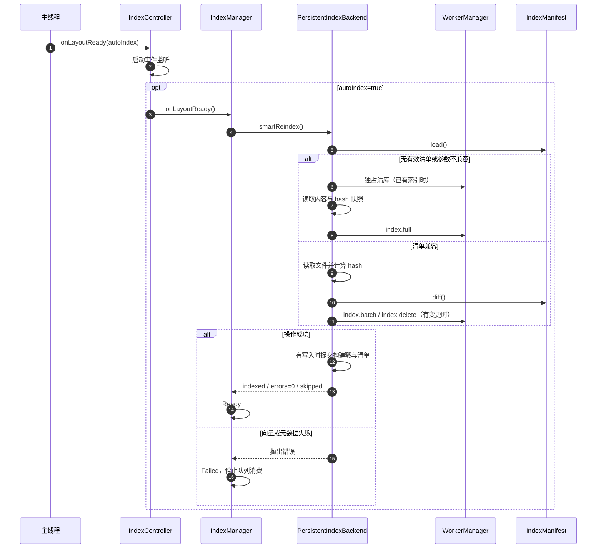
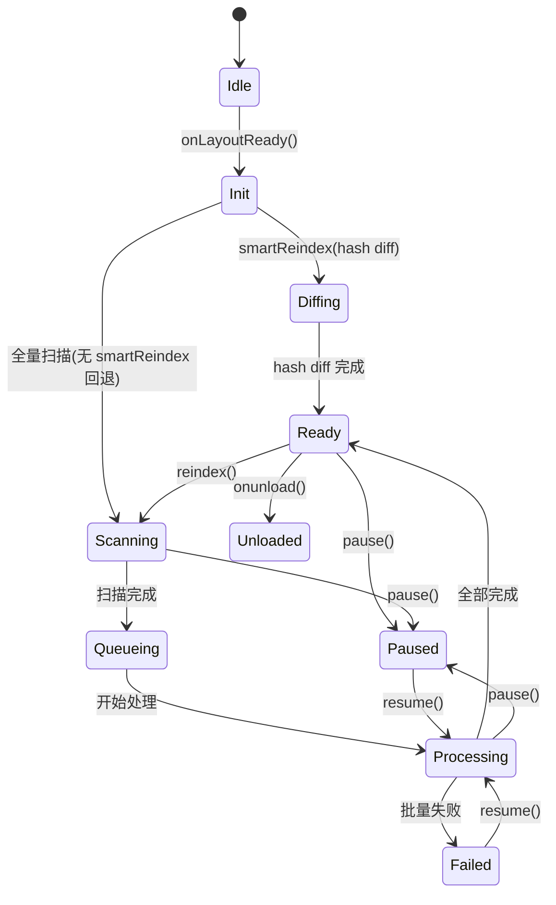
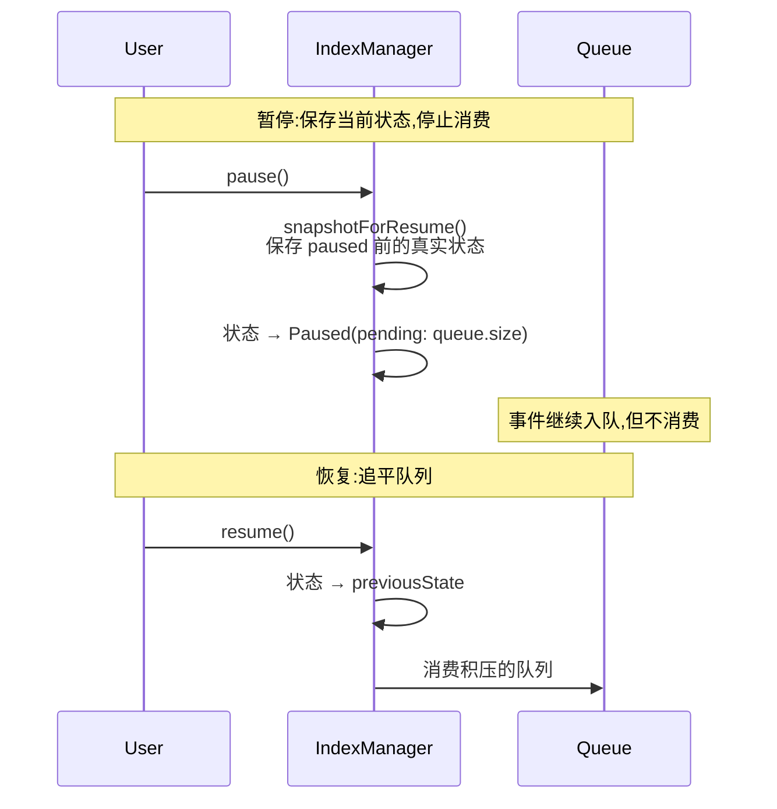
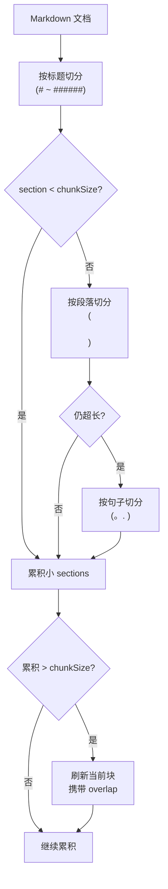
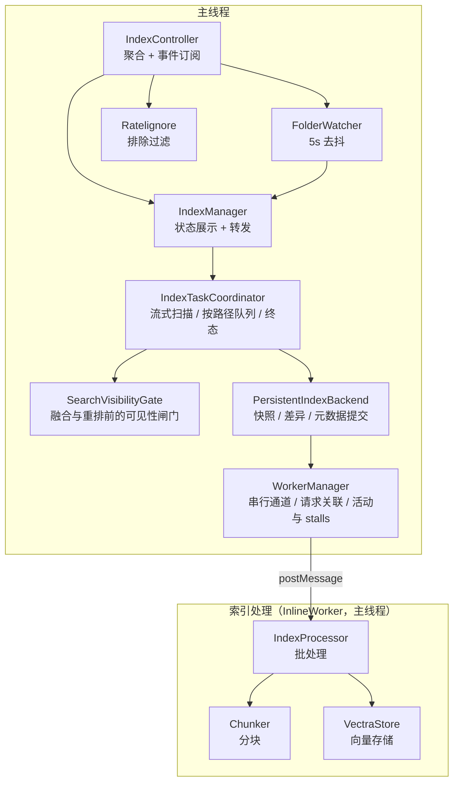

# 向量索引子系统

> 领域:RAG | 数据预处理流(生产者)
> 详细设计:文档发现 → 分块 → 向量化 → 存储 → 增量同步

---

## 1. 职责

将 Obsidian vault 中的 Markdown 文档转化为可检索的向量索引,并保持索引与文档的实时同步。

**不做的事**:
- 不负责查询(查询属于 [retriever](retriever.md))
- 不负责模型管理(模型属于 [model-management](../llm/model-management.md))
- 不负责 UI 展示(UI 属于 [obsidian-integration](../host/obsidian-integration.md))

---

## 2. 设计原则

### 2.1 Worker 内 embed,主线程不碰索引文件

**决策**:索引时 embed 在 Worker 内完成(vectra 内部调 `createEmbeddings`),而非主线程 embed 后传向量给 Worker。

**原因**:
- 批量 embed 是 CPU 密集任务,放 Worker 不卡 UI
- vectra 的 `LocalDocumentIndex` 构造时注入 `EmbeddingsModel`,内部 `addDocument()` 自动调 `createEmbeddings`,无需外部手动传向量
- 查询时主线程 embed 单条查询(ms 级),不卡 UI

**权衡**:索引和查询的 embed 位置不一致(索引在 Worker,查询在主线程),但同一 `EmbeddingsModel` 实例保证维度一致。

### 2.2 同 path 去重,单文件失败不挂整批

**决策**:协调器的事件队列按路径合并（`mergeQueued`），同文件多次变更只保留一项，并只保存路径与事件序号；队列不保留全库正文。

**原因**:Obsidian 保存文件会连续触发 modify 事件，不去重会导致同一文件重复索引。队列内存在大库下有界：3000 篇实测 `queued` 峰值等于文件数，读取是「按需读单篇 + 用完即弃」。

**单文件失败**:失败按路径保留在计数里，不把整库标成可用；其他文件继续提交，失败范围可定位。

### 2.3 5s 单文件去抖,delete 不去抖

**决策**:FolderWatcher 对 create/modify 事件 5s 去抖,delete 立即处理。

**原因**:用户编辑时频繁保存,5s 内的多次变更合并为一次索引;文件删除是确定性操作,延迟处理会导致搜索到已删除的文档。

### 2.4 .ratelignore 排除,默认排除 .obsidian/

**决策**:用 `ignore` 包解析 `.ratelignore` 文件,默认排除 `.obsidian/`、`.git/`、`.trash/` 等。

**原因**:用户可能不想索引某些目录(如模板、归档),提供灵活的排除机制。

---

## 3. 核心流程

### 3.1 全量索引(首次打开 vault)



### 3.2 增量索引(文件变更)



### 3.3 文件删除



### 3.4 Smart Reindex（启动期增量，历史路径）

> 该时序描述 `PersistentIndexBackend.smartReindex` 的历史形态。协调器（`IndexTaskCoordinator`）接入后，扫描、队列与终态由协调器驱动，`IndexManager.runCoordinator` 不再调用 `smartReindex` / `fullReindex`；公共 `smartReindex()` 已删除，其「整批成功才存清单」的路径由逐文件持久提交取代。

`IndexManager` 协调扫描与事件队列，`PersistentIndexBackend` 负责以下决策和元数据提交。



**关键决策**：

- 启动扫描、事件队列与终态由协调器（`IndexTaskCoordinator`）驱动，`IndexManager` 只负责状态展示与转发；每次启动解析配置代际，只有活动代际的完成记录参与检索。
- `autoIndex=false` 走只读通道：不扫描、不嵌入、不取写所有权、不写盘，只读已完成记录并核验本次候选的存在性与黑名单，新鲜度显示 `unknown`。
- 已有持久提交的未修改文件零重复嵌入；当前仍读取并逐文件核对内容 hash，不能称为零 IO。
- 缺少可信完成记录时不假定旧向量可用：该路径必须重新嵌入后取得完成记录，才重新可检索。
- 任意运行错误向上传递，不自动清库重试。停滞只改阶段，任务与队列继续持有；恢复完成或显式取消才结束。
- 「重建当前索引」在注入协调器时执行撤销在途调用后逐文件重新核对，不清空现有索引；清理非活动代际是单独命令。


---

## 4. 状态机

### 4.1 IndexStatus(10 态)



| 状态 | 含义 | UI 表现 |
|---|---|---|
| Idle | 初始状态,未启动 | 不显示 |
| Init | 正在初始化 | Banner: "正在初始化..." |
| Diffing | smartReindex hash diff 阶段 | Banner: "正在比对..." |
| Scanning | 正在扫描 vault 文件 | Banner: "扫描中 23/100" |
| Queueing | 文件已入队,等待处理 | Banner: "排队中 15 个" |
| Processing | 正在处理索引 | Banner: "处理中 [file1, file2]" |
| Ready | 索引就绪 | 不显示(或徽章:已索引 234 篇) |
| Paused | 用户暂停 | Banner: "已暂停 15 个待处理" |
| Failed | 索引失败 | Banner: "索引失败: 原因" |
| Unloaded | 插件卸载 | 不显示 |

### 4.2 暂停/恢复机制



**关键**:暂停前必须用 `get(status$)` 读取真实状态,不能 hardcode(如 `{ state: 'Ready' }`),否则在 Scanning/Failed 状态暂停后恢复会丢失状态。

### 4.3 协调器阶段

协调器持有独立的阶段判据 `IndexPhase`，与 `IndexStatus` 并存、由状态展示层汇总：

```typescript
type IndexPhase =
  | 'scanning' | 'processing' | 'stalled' | 'stopping'
  | 'paused' | 'partial-failure' | 'failed' | 'ready';
```

- **`stalled`:** 长时间没有有效进展。停滞只改阶段，任务与队列继续持有（`queued > 0`、`canMarkReady === false`），不丢终态。
- **`stopping`:** 取消已撤销 epoch 并停止调度新文件，正在等待在途提交结束。
- **`partial-failure`:** 本轮有失败路径时逐文件保留可用部分，不把整库标成可用。
- **`ready` 判据:** `canMarkReady` 要求扫描结束、队列与在途均为空、无未结事务、无失败路径，四者同时成立。
- **状态展示:** 总文件数、已提交数、待处理数和失败数分别呈现；变更导致待处理量增加时提示「重新核对」；只有真实全库完成才发送全量完成 Notice。

---

## 5. 分块策略

### 5.1 三级回退



### 5.2 参数

| 参数 | 默认值 | 说明 |
|---|---|---|
| chunkSize | 500 字符 | 目标分块大小 |
| overlap | 100 字符 | 分块间重叠,避免语义断裂 |

### 5.3 docId 命名

```
{filePath}#chunk-{index}
```

例如:`notes/LangChain.md#chunk-0`

同一文件的多个 chunk 共享 `metadata.path`,检索后按文档聚合。

---

## 6. 索引存储

### 6.1 目录布局

`.index/` 根只放控制与互斥文件；**每个配置代际的全部数据**落在 `generations/<generationId>/` 下：

```text
.index/
├── control.json               ← 代际控制指针(schema 2:activeGenerationId + generations 表)
├── owner.lock                 ← 跨实例写所有权锁
├── owner.recovery.lock        ← 锁回收时的排他恢复门
└── generations/
    └── gen-<fingerprint[0:16]>/
        ├── generation.json          ← 代际入口记录(归属校验依据)
        ├── config.json              ← 该代际的配置快照(向量空间身份)
        ├── index.json / catalog.json / <uuid>.json   ← Vectra 数据
        ├── ratel-manifest.json      ← 代际作用域清单(派生视图)
        ├── build-stamp.json         ← 代际作用域构建戳
        ├── files/<pathHash>.json    ← 文件完成记录(receipt)
        ├── pending/<transactionId>/ ← 未结算事务(分片 + prepared.json)
        ├── quarantine/              ← 隔离区
        └── migration.json           ← 旧索引迁移的可重入进度
```

**归属校验:** 代际目录名必须匹配 `gen-<16 位十六进制>`，`dirname` 必须等于所属 `generations/`，且入口记录形状自洽并已登记在 `control.json`。递归删除只有 `IndexGenerations.dropSafeGeneration`（拒绝 `.index` 根与 `generations/` 聚合目录、拒绝活动代际）与 `VectraStore.dropIndex()`（形状白名单）两个入口；`deleteFolder` 拒绝代际根，其余递归删除都经统一的路径包含性校验。

**清单路径演进:** 旧版写在插件根目录 `index-manifest.json`，易被 Remotely Save 等同步工具删掉 → 每次启动误判「无清单」。现在写路径启动时把旧文件迁入 `.index/` 根，再逐文件核入代际目录；只读装配不执行该迁移。

**清单与 data.json 分离:** 清单记录每文件 sha256 + mtime + chunkCount + 全局参数，独立于 data.json，不走 Obsidian loadData/saveData。

### 6.2 配置代际

代际由**配置指纹**（`configIdentityOf(fingerprint)`，显式字段白名单按固定顺序序列化后 SHA-256）派生标识 `deriveGenerationId(fingerprint)`。凭证（`apiKey` / `baseUrl`）与临时任务状态是构造性排除项：改动它们不产生新代际。

- **活动指针:** `control.json` 的 `activeGenerationId` 指向当前可检索的代际。启动时若配置指纹与活动代际一致，直接复用；不一致则新建隔离代际，本轮逐文件核对 / 提交全部完成后才以 `configured-switch` 原子切换指针，**部分失败不切**。
- **首次建库:** 无活动代际时，首个文件持久提交后即可登记活动代际并部分检索，不必等全库完成。
- **切回旧配置:** 先 `beginVerification` 把该代际降级为核对中，逐文件复核当前内容后才恢复可检索；从不直接恢复旧的 Ready 结论。
- **旧索引迁移:** 在写所有权锁内只读复制旧 Vectra 数据与外置 metadata 到独立代际目录，核对复制摘要后逐文件写完成记录，最后原子发布 `control`。旧数据保留，中断可重入且不重复嵌入；空间不足只报告失败，不先删旧数据腾空间。旧分块器身份无法确认时不假设兼容，整个代际不建立。
- **回收:** 默认最多一个活动代际加一个待建 / 回退代际；第三配置出现时只回收无活动提交、无未解决事务的非活动代际，回收不动则暂停新建并保留可用活动索引。所有清理都在写所有权锁内并复核目录归属。
- **未交付的形态:** 「因空间不足等原因无法建新代际时，让旧配置代际继续只读可用、新配置暂不写」这一模式**尚未实现**；当前行为是整库降级（详见 §8）。

### 6.3 文件级提交

每个文件的写入是一条**先持久暂存、再原子替换、最后确认**的链，由 `IndexFileJournal` 实现：

| 阶段 | 产物 | 语义 |
|---|---|---|
| prepare | `pending/<transactionId>/part-*.json` 分片 + `prepared.json` | 保存足以重放的向量与目标提交，`prepared.json` 分片齐全后才原子落盘 |
| commit | 先 `replaceFile` 替换该路径全部块，再写 `files/<pathHash>.json` 完成记录 | 删除与插入在同一事务内；完成记录落盘后才认为该文件可用 |
| receipt | `FileCommit`（`state: 'present'` 或 `'deleted'`） | `present` 携带 `inputHash` 与 `chunkCount`；`deleted` 携带 `inputHash: null`、`chunkCount: 0`，作为删除凭据而不在清单视图中出现 |

- **`deleted` 凭据:** 删除以 `state=deleted` 的完成记录持久化，`blockSetHash` 取空集常量。同路径重新创建时 `revision` 单调递增；删除凭据在事务完成前不会被抹掉。
- **`revision`:** 同路径每次提交递增，只要求单调、不要求 +1。`prepared` 的新 `revision` 必须大于其声明的上一版本，`parts` 计数之和必须等于 `chunkCount`。
- **单一在途:** 同路径同时只允许一个未决 `prepared`（`path-in-flight`）；后继提交必须核对并结算前驱。完成记录已是更高 `revision` 时，旧日志只允许清理，禁止覆盖后继版本。
- **空文件:** 以 `present` 且 `chunkCount: 0`、`inputHash` 等于空内容 hash 的完成记录持久化，区别于删除凭据。

### 6.4 恢复决策

`IndexFileJournal.recover()` 在启动装配时逐事务判定，覆盖全部六种情形：

| 磁盘情形 | 动作 |
|---|---|
| `prepared` 无效但可可信归属 | 隔离该路径（`quarantined-path/invalid-prepared`）并重算 |
| `prepared` 无法归属 | 隔离整个代际（`quarantined-generation/unattributable-prepared`） |
| 完成记录 `revision` 高于 `prepared` | 只清理旧日志，禁止覆盖后继（`cleanup-only/receipt-ahead`） |
| `prepared` 有效且当前输入匹配 | 检查完整块集合后补写完成记录或重放（`repaired-receipt/*`、`replayed/*`） |
| `prepared` 已过期且磁盘仍是旧提交 | 保留旧的完整结果，把当前版本排队（`requeue-current/*`） |
| `prepared` 已过期且磁盘含过期新提交 | 持久记录该路径不可用（`blocked-current/*`），再把当前版本排队 |
| 完成记录与实际块匹配，仅清理未完成 | 只清理，不再调用嵌入（`cleanup-only/receipt-matches-prepared`） |

- **空事务不升级为代际隔离:** 「无记录、零分片」的事务目录按无内容直接清理（`cleanup-only/empty-transaction`），只有「有记录不可信」或「有分片却无法归属」才隔离代际。
- **失败范围可定位:** 逐事务 try/catch，单个事务失败只计入报告的 `failures`，不影响其余事务；代际被隔离后立即停止本代际的恢复，不再清理或替换向量。
- **出口:** 路径隔离由成功提交当前版本后自动清除；代际隔离需要显式解除（`clearGenerationQuarantine({ confirm: true })`）。
- **回滚与 fs 错误:** 裸 fs 错误收敛为 `io-failure` 稳定码，保留 `errno` / `cause`，消息不含绝对路径。
- **隔离区三种内容:** `quarantine/<pathHash>.json`（被隔离路径状态）、`quarantine/generation.json`（代际隔离记录，存在即视为隔离）、`quarantine/transactions/<id>/`（仍需保留依据的事务）。当前版本成功提交、路径状态清除后自动回收对应的隔离事务；`reclaimOrphanQuarantinedTransactions()` 只回收**不再被任何路径状态引用**的孤儿事务，返回 `{ reclaimed, retained }`，不误删仍需要的依据。

### 6.5 原子存储

`AtomicIndexStorage` 实现 Vectra 的 `FileStorage` 扩展点，被注入每个 `VectraStore` 构造点：

1. 同目录唯一临时名（`.tmp-` 前缀，`wx` 排他创建）→ 写入 → 文件 `fsync` → 关闭 → `rename` → 支持的平台上同步父目录。
2. 结果分三态判定：`renamed`（提交成功）、`failed-before-rename`（磁盘必为完整旧版）、`unknown-after-rename`（磁盘可能是新版）。
3. **失败后必须重载验证**，不能一律按旧版仍在磁盘继续搜索。写失败清理不遮蔽原始错误；`createTempPath` 的拼接结果二次校验包含性，临时文件失败不残留。
4. 锁与恢复门文件用**临时文件 + fsync + `link`** 落项 —— `link` 在目标已存在时以 EEXIST 原子失败，而 `rename` 会覆盖；平台不支持硬链接时按稳定错误码失败，不退化成建空文件。
5. `flushPath()` 提供显式落盘，供写完成记录等关键提交点调用。
6. 故障注入覆盖短写、短写 0 字节、`ENOSPC`、`rename` 失败、目录 `sync` 失败与 `openDirectory` 不支持；断言失败后读回的 JSON 必为完整旧版或完整新版，不存在半截文件。

**耐久性口径:** 分片与 `prepared.json` 是可重算的暂存数据，「没有 `prepared.json` 的事务」在启动时被判为不可重放并重算；向量替换（`index.json`）与完成记录才是提交点。小库档首次构建耗时未达成计划写死的相对门槛，原因与边界见 [T8b-1 证据](../../superpowers/plans/2026-10-31-index-reliability-t8b1-evidence.md)。

### 6.6 metadata 结构

```typescript
{
  path: string;        // 原始文件 vault 路径
  chunkIndex: number;  // 分块序号
  startOffset: number; // 原文起始偏移(UI 高亮定位)
}
```

### 6.7 索引新鲜度

- 完成记录记录每文件 sha256 与块数，启动期逐文件读取并核对内容 hash，mtime 只作快照信息，不作为跳过内容核查的依据
- 未变更文件零重复嵌入；变更只影响对应文件，其他文件的完成记录直接复用
- 文件变更时由协调器按路径合并入队，无需全量重建
- 普通修改在提交前标记 `known-stale`，检索立即过滤旧版本；删除、被排除、损坏、未解决事务立即判定为不可用
- 代际解析失败、磁盘写入失败或装配失败时如实降级并给出重试入口，不自动清库重试

---

## 7. 组件协作



**组件职责**:

| 组件 | 职责 | 位置 |
|---|---|---|
| IndexController | 聚合 IndexManager + FolderWatcher + Vault 事件 + .ratelignore;`autoIndex` gate 决定写入或只读通道 | 主线程 |
| IndexManager | 状态展示与事件转发;注入协调器后不再走整批重扫入口 | 主线程 |
| IndexTaskCoordinator | 流式扫描、按路径合并的事件队列、单调事件序号、逐文件新鲜度与单文件持久提交 | 主线程 |
| SearchVisibilityGate | 统一候选可见性判定,在融合与重排之前过滤 | 主线程 |
| FolderWatcher | 5s 单文件去抖,delete 不去抖 | 主线程 |
| Ratelignore | 解析 .ratelignore,过滤排除文件 | 主线程 |
| PersistentIndexBackend | 文件日志读写、向量与元数据提交、代际迁移；失败向上传递 | 主线程 |
| IndexFileJournal | prepare / commit / recover 与隔离区管理,唯一持有文件级提交语义 | 主线程 |
| IndexGenerations | 配置指纹、活动指针、迁移与代际回收 | 主线程 |
| IndexWriteOwner | 跨实例写所有权与根目录排他锁,epoch 撤销旧实例提交权 | 主线程 |
| WorkerManager | 共享索引串行访问、进度关联、活动停滞与取消 | 主线程 |
| AtomicIndexStorage | 唯一临时文件 + rename + flush 的原子替换,注入每个 VectraStore | 主线程 |
| IndexProcessor | 批量索引处理(分块 + upsert);经 `replaceFile` 完成删除与插入的同一事务 | InlineWorker（主线程） |
| Chunker | Markdown 三级分块 | InlineWorker（主线程） |
| VectraStore | 向量存储(upsert/search/replaceFile/inspectFile/reload/dropIndex) | InlineWorker（主线程） |

---

## 8. 边界

| 与...的接口 | 方向 | 协议 |
|---|---|---|
| [model-management](../llm/model-management.md) | 依赖 | EmbeddingsModel 实例注入 Worker |
| [retriever](retriever.md) | 提供 | VectraStore.search() 供向量检索；可见性闸门在融合前过滤 |
| [obsidian-integration](../host/obsidian-integration.md) | 依赖 | Vault 事件 + 文件读取 |
| [persistence](../host/persistence.md) | 依赖 | 索引目录 + .gitignore |
| [worker-protocol](../host/worker-protocol.md) | 依赖 | 活动包、取消与迟到终态通道 |
| [index-controller](../host/index-controller.md) | 被驱动 | 只读通道、装配降级与重试入口 |

**已交付边界:** 用户可见行为以本分支实测证据为准；「回收受阻时旧配置代际继续只读可用」模式未实现，当前为整库降级。
