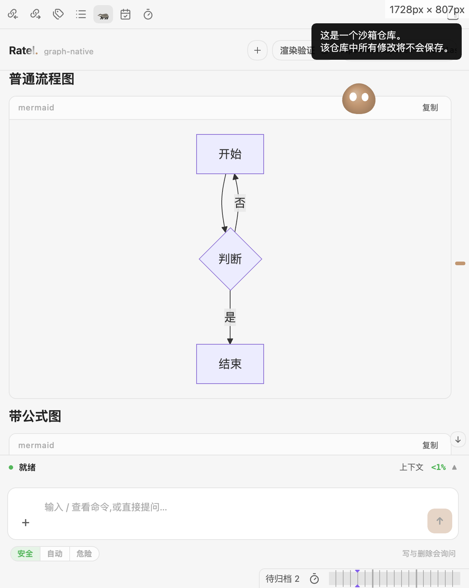
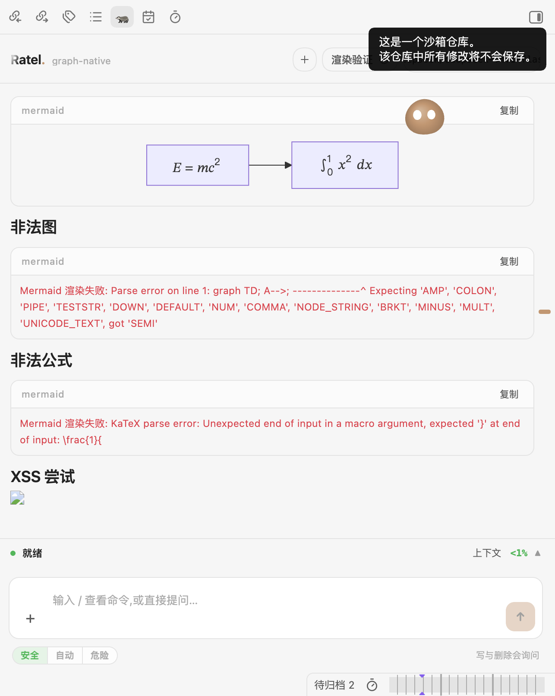

# 发布前证据记录（2026-11-10）

- 基线：`develop` 提交 `7c37b95`；上一正式 tag `1.5.3`（2026-11-10 11:04）。本记录覆盖 tag 之后的收尾改动，尚未改版本号、打 tag 或发布。
- 本记录的 11 月 10 日基线清单版本为 `1.5.3`；以下验证数据均保留当时口径。11 月 14 日的发布准备已将版本同步为 `1.5.4`，补充记录见文末；截至准备阶段尚未打 tag 或发布。
- 本文只记录已执行的验证与裁定，不把未覆盖场景写成已通过。

## 一、包体与分发限制

### 裁定

- 不再以「低于 5 MB」作为发布门槛，保留当前约 9.2 MiB 的主包。
- 不为凑体积裁掉 Mermaid 图类型，也不大改 Worker 分发方式。
- 超出 Obsidian Sync Standard 单文件上限的事实如实记录，不隐藏、不用「可忽略」替代说明。

### 实测

| 项 | 结果 |
| --- | --- |
| `dist/main.js` | 9,659,493 B（约 9.21 MiB） |
| 本轮增量 | 相对 9,646,244 B 增加约 13 KB，主要来自可访问性包装，含少量记账修复 |
| `npm run build` | 退出码 0，无 error |
| 主包内 `gpt-tokenizer` / `wink-*` 的 `bytesInOutput` | 均为 0 |

### Sync Standard 限制的准确表述

按当前已知的 Obsidian Sync Standard 单文件 5 MB 上限，`main.js` 超出该限制。影响是：启用 Sync Standard 时，该插件主文件无法通过 Sync 同步；插件的社区商店 / BRAT / 手动三文件安装与本地运行不依赖 Sync。文档不得表述为「已适配 Sync Standard」或「体积不影响同步」。

## 二、Tokenizer 与 BM25：行为不变确认

### 结论

主包把 `gpt-tokenizer` 与 BM25 相关模块替换为空模块，但**没有改变现有的分块、索引、检索与回退行为**。理由与边界如下，本节是把既有审计结论固化为正式记录，不新增机制。

### 调用面

| 路径 | 是否受替换影响 | 依据 |
| --- | --- | --- |
| 索引线程写入 | 否 | `chunkMarkdown` 使用 `TokenCounter`，索引线程构建保留真实 GPT 分词 |
| 主线程回退写入 | 否 | 同样走 `chunkMarkdown` + `replaceFile`，不调用 vectra tokenizer |
| 记忆索引写入 | 否 | 预计算向量直接 `upsertItem`，不分块 |
| 检索 | 否 | 调用 `queryItems(queryVector, '', topK * 10)`，`filter` 与 `isBm25` 均为 `undefined` |
| 主线程文档级 `vector.upsert` | 理论可达 | 若被调用会使用可逆的码点级降级 tokenizer；`src/` 内没有发送方，仅类型定义与测试存在 |
| 测试与可靠性子进程 | 否 | 构建常量保持 `__RATEL_VECTRA_GPT_TOKENIZER__ = true`，使用真实 GPT 分词 |

### 构建常量与 BM25

- 主包：`__RATEL_VECTRA_GPT_TOKENIZER__ = false`；索引线程与历史 Worker：`true`。
- BM25 引擎只在 `LocalIndex.queryItems(..., isBm25 = true)` 时创建；本仓库没有 4 参数调用，`src/` 与 `tests/` 无 `isBm25` 字面量。
- 主构建与索引线程构建对 `wink-bm25-text-search` / `wink-nlp` / `wink-eng-lite-web-model` 的替空只影响体积，不影响运行时创建路径。

### 不夸大的边界

不声称降级 tokenizer 绝对不可达。若未来在主线程新增文档级 `upsert` 调用，它会使用码点级分块；该约束已写在 `src/adapters/vectra-tokenizer.ts` 文件头，届时应改走索引线程或恢复真实词表。

## 三、Mermaid / KaTeX 真实渲染

### 环境与材料

- 采集时间：2026-11-10 16:42。
- 宿主：Obsidian Sandbox 桌面端，加载本地构建产物；渲染链路不在本轮与记录覆盖的收尾改动内。
- 材料：同一笔记内的 Mermaid 代码块与公式，覆盖正常与异常输入。

### 用例与结果

| 用例 | 结果 |
| --- | --- |
| 普通流程图 | 正常渲染为 SVG，节点、连线与中文标签完整 |
| 带公式图 | `E = mc²` 与 `∫₀¹ x² dx` 正常渲染，布局与字体可见 |
| 非法 Mermaid | 显示「Mermaid 渲染失败: Parse error…」，错误被隔离在代码块内，聊天与索引状态不受影响 |
| 非法公式 | 显示「Mermaid 渲染失败: KaTeX parse error…」，未影响同页其他块 |
| XSS 尝试 | 注入内容未执行脚本，仅留下被净化的节点占位；未出现弹窗或状态异常 |

### 结论与限制

- 真实宿主渲染通过：Mermaid 11.16.1 与 KaTeX 0.18.11 的组合可正常出图，异常输入有可见错误而非崩溃。
- 本轮证据为真实宿主截图；未新增自动化视觉回归。字体、布局结论仅覆盖 macOS 桌面 Sandbox 的当前主题。

## 四、Svelte warning 逐条处置

`npx svelte-check` 初始为 0 error / 19 warnings，现为 0 error / 8 warnings。逐条判断如下。

### 已修复（11 条）

| # | 位置 | 问题 | 处置 |
| --- | --- | --- | --- |
| 1 | `ThinkingOrb.svelte` | `<canvas role="img">` 角色不合法 | 外层 `div` 承载 `role="img"` 与标签，canvas `aria-hidden="true"` |
| 2 | `ThinkingOrb.svelte` | `display: block` 下 `vertical-align` 无效 | 删除死 CSS |
| 3 | `SlashMenu.svelte` | `role="option"` 缺 `tabindex` | 补 `tabindex="-1"` |
| 4 | `SlashMenu.svelte` | 可点击元素无键盘处理 | 补 Enter / Space 选择 |
| 5 | `SearchResults.svelte` | `<button role="listitem">` 角色不合法 | 移除 `list` / `listitem` 角色，保留按钮语义 |
| 6 | `MessageList.svelte` | `.ratel-messages.ratel-scroll-snap` 被判未使用 | 改为 `.ratel-messages:global(.ratel-scroll-snap)`；该类由 `sticky-scroll.ts` 运行时挂上，删掉会丢失瞬时滚底行为 |
| 7 | `ChatNavRail.svelte` | 点列容器有指针事件但无角色 | 补 `role="presentation"`（纯悬停热区） |
| 8 | `ChatNavRail.svelte` | 点列行有指针事件但无角色 | 补 `role="presentation"`（纯悬停热区） |
| 9 | `SessionMenu.svelte` | `role="menu"` 缺 `tabindex` | 补 `tabindex="-1"` |
| 10 | `ChatProfileMenu.svelte` | `role="menu"` 缺 `tabindex` | 补 `tabindex="-1"` |
| 11 | `GlareHover.svelte` | 装饰容器有指针事件但无角色 | 补 `role="presentation"` |

### 保留（8 条，均为 `state_referenced_locally`）

| # | 位置 | 保留理由 |
| --- | --- | --- |
| 12 | `CountUp.svelte` | `$state(value)` 只取初值；同文件 `$effect` 在 `value` 变化时重新读取并动画，初值不会陈旧 |
| 13 | `ThinkSegment.svelte` | `$state(streaming)` 只取初值；`$effect` 在 `streaming` 变化时同步展开态 |
| 14 | `ChatNavRail.svelte` | `lastEmittedSide = side` 是挂载期初值；`$effect` 在非拖拽时同步 `side` |
| 15–17 | `ChatView.svelte` | `plugin` 是视图生命周期内稳定的插件实例；三个 `const` 保存 store 引用给 `$store` 自动订阅，改成 `$derived` 会失去自动订阅 |
| 18–19 | `WelcomeTypeLine.svelte` | `$state(play ? '' : text)` 只取初值；`$effect` 在 `play` / `text` 变化时重置逐字状态 |

构建期 `esbuild-svelte` 报告 6 条 warning，为上述保留项的子集；源码级 `svelte-check` 为 8 条，未出现新增 error。

## 五、计时器与卸载清理

逐项检查 `.svelte` 内的 `setTimeout` / `setInterval` / `requestAnimationFrame` 与事件监听：

| 组件 | 计时器 / 监听 | 清理 |
| --- | --- | --- |
| `ChatView.svelte` | 导航闪动、错误停留、重试倒计时、提及防抖、压缩失败延时 | 导航/错误/压缩失败 timer 与重试 interval 均在 `onDestroy` 清理；提及防抖有 effect cleanup |
| `WelcomeTypeLine.svelte` | 逐字 `setInterval` | effect cleanup + `onDestroy` |
| `RotateHint.svelte` | 轮换 `setInterval` | effect cleanup + `onDestroy` |
| `MessageList.svelte` | 计时 `setInterval`、文档焦点/选区监听 | interval cleanup；监听在 effect cleanup 中移除 |
| `TitleDissolve.svelte` | 退场 `setTimeout` | effect cleanup |
| `EchoText.svelte` | `requestAnimationFrame` + `setTimeout` | effect cleanup 同时取消两者 |
| `CountUp.svelte` | 计数 `requestAnimationFrame` | effect cleanup 取消 |
| `ParticleText.svelte`、`ClickSpark.svelte`、`ChatMascot.svelte` | 动画帧循环 | effect cleanup / `onDestroy` 取消 |
| `ThinkingOrb.svelte`、`AuroraBackdrop.svelte`、`LineWavesBackdrop.svelte`、`SoftAuroraBackdrop.svelte`、`OrbBackdrop.svelte` | 动画帧、可见性/指针监听 | effect cleanup / `onDestroy` 取消与移除 |
| `MarkdownView.svelte` | 渲染帧、选区/鼠标监听 | effect cleanup 与 `onDestroy` |

本轮补上的清理：`ChatView.svelte` 的压缩失败延时（2500 ms）此前没有句柄，视图卸载后仍可能改写状态；现记录为 `compactFailTimer`，在重新调度前与 `onDestroy` 时清除。

所属窗口说明：以上计时器均在其组件所在的 Obsidian 渲染进程窗口内创建，并使用同一窗口的清理 API；未发现跨窗口创建/清理不配对的情况。一次性 `requestAnimationFrame` 与 `sleep()` 延时为自终止调用，不保留需要额外清理的句柄。

## 六、未覆盖场景（不作为本次发布门槛）

| 场景 | 状态 | 说明 |
| --- | --- | --- |
| 真实 GPU 设备丢失 | 未覆盖 | 仅验证过注入 `gpu:lost` 与强制端路径；未在真实硬件掉卡场景复现 |
| 真实 120 秒挂起 | 未覆盖 | 回退路径用注入超时/终止验证；未复现真实 120 秒无响应 |
| WASM 整库重索引耗时 | 未覆盖 | 本轮未测全库 CPU 重建耗时 |

三项均记录为未通过，不写成已验证。本记录覆盖的收尾改动没有修改这些链路；发布范围内既有的回退修复只做过注入验证。验证中若出现新的失败，再单独处理。

## 七、其它登记项（本轮不改产品行为）

- `ecosystemWriteEnabled` 保持现状，默认值与行为均不变。
- 开发依赖公告（全量 `npm audit` 的 13 条 moderate）只登记，独立处理；生产依赖审计为 0，发布产物不包含这些开发链包，不使用 `npm audit fix --force`。
- Mermaid 图类型完整保留；Worker 分发方式未改。

## 八、本轮验证命令与结果

| 命令 | 结果 |
| --- | --- |
| `npm run build` | 退出码 0；`dist/main.js` 9,659,493 B；6 条构建 warning（保留项子集：3 条 `plugin`、1 条 `side`、1 条 `value`、1 条 `streaming`） |
| `npm run typecheck` | 退出码 0；`svelte-check` 0 error / 8 warnings（5 个文件） |
| `npm run lint` | 退出码 0；0 warning |
| `npm test` | 退出码 0；342 个测试文件通过 / 6 个跳过（348）；3170 个用例通过 / 27 个跳过（3197） |

## 九、固定缺陷清单（发布范围）

全量测试首轮曾因 D-01 失败；修复后复跑全绿。D-01 为本轮验证发现并修复的回归，未进入已发布版本。

| # | 缺陷 | 影响 | 修复 | 来源 |
| --- | --- | --- | --- | --- |
| D-01 | `markDeleted` 把已删除路径加入 `verified` | `committed` 把已删除笔记计入，启动对账出现 2897 vs 实际 2877 | 拆出独立 `deleted` 集合只做删除幂等，`committed` / `total` 不再包含已删除路径 | 本轮引入（`7c37b95`），验证中修复，未进入已发布版本 |
| D-02 | 预热的 GPU 实例终止后仍被复用 | 下一次推理等到 120 秒超时 | 终止时同步清空 `prewarmed` 引用，退出后的实例不再被重新接管，下次请求重建 | 1.5.3 既有 |
| D-03 | GPU 运行期超时或 `gpu:lost` 不回退 | 界面长期停在索引中 | 连续失败回退 WASM，并回写后端徽标 | 1.5.3 既有 |
| D-04 | 删除笔记不写墓碑完成记录 | 失效记录每轮启动重新排队 | 删除走日志事务，写 `deleted` 墓碑并清空块 | 1.5.3 既有 |
| D-05 | 增量入队后不驱动消费 | 新事件停在待处理，状态停在处理中 | 协调器入队后触发一次非阻塞消费 | 1.5.3 既有 |
| D-06 | 增量重写沿用上一轮核验标记 | 已写块数冻结在上一轮 | `notify(upsert)` 清理核验/分块/落盘标记并结算预估 | 1.5.3 既有 |
| D-07 | 块级事件装配被对象展开固化 | `stored` 与分母恒为 0 | 用访问器直连真实客户端 | 1.5.3 既有 |
| D-08 | 图表外框内的 HTML / MathML 被清洗 | 公式图空白 | 保留 `foreignObject` 内容并保持错误隔离 | 1.5.3 既有 |
| D-09 | 忽略规则不跟随自定义配置目录 | 自定义 `configDir` 下忽略规则失效 | 读取 vault 的 `configDir` | 1.5.3 既有 |
| D-10 | 状态行不能用键盘展开 | 键盘用户无法展开状态 | 补键盘展开与可见焦点 | 1.5.3 既有 |

## 十、1.5.4 发布准备补充（2026-11-14）

- 版本四处同步为 `1.5.4`，最低宿主版本 `1.13.1`；远端尚无同名 tag。准备阶段不提交、不推送、不打 tag。
- 主面板只显示核对篇数或本轮完成块数；总量仍含预估时使用不定进度，隐藏精确分母、百分比和速率。落盘、提交与复用保留在折叠诊断中，正常就绪后隐藏入口，失败和异常提示保留入口。
- 升级弹窗已改为本版变化与必要注意事项，去掉上一版说明与“已有索引不需要重建”的绝对保证；首次核对可能重新处理部分笔记，无需手动清空索引。README、双语用户指南与 CHANGELOG 同步，临时材料不纳入发布提交。
- `npm run typecheck` 退出码 0，0 errors / 8 条既有 warnings；`npm run lint` 退出码 0、无告警；生产构建通过，6 条既有构建 warnings。产物通过无 deprecated display 和无空设置 stub 门禁。
- 全量首轮有 1 项 `index-thread-e2e` 的 5 秒超时；该文件单跑通过。降低并发后执行 `npm test -- --maxWorkers=2`，退出码 0，343 文件通过 / 6 跳过，3182 用例通过 / 27 跳过。不据复跑结果宣称首轮未失败，也不把高负载推断当作根因定论。
- `npm audit --omit=dev --json` 退出码 0，生产依赖公告 0。
- 用户提供的本次启动日志：核对 2889 篇，复用 61859 块，写入 0 篇，失败 0，对账差值 0。这是一次启动成功的证据，不代表所有增量或异常场景均已验证。
- 既有计划中未闭环的硬件故障与性能验收继续保留，不因补丁准备而标成完成；本轮不自动归档。
