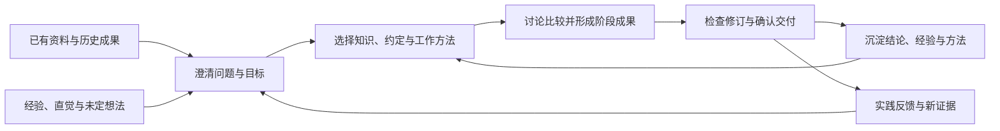

# Ratel 2.0 整体产品需求

> 2026-10-23 · PRD 草案 v0.7 · 已按确认口径补齐材料能力状态、检索验收及范围收回；故事修订稿与交付范围仍待审阅，不构成 2.0.0 发布范围或实施授权。

**构建面向 AI 时代的知识沉淀、消费与生产能力。**

让已有知识能够支撑人与 AI 的工作，让工作中形成的新知识和成果得到积累，并在后续使用中不断完善。Ratel 以 Obsidian 为知识与工作环境，帮助用户从资料、经验和想法出发，逐步形成有依据、可修改、可复用的成果。

本文定义产品目标、能力全景、范围边界和共同验收原则；具体产品行为在能力分册维护。先读本页，再按问题查阅分册；交付顺序只在[演进路线](../../roadmap/2.0.md)维护。总体方向已确认，不等于分册、故事和版本范围均已批准。

## 1. 产品定位与目标用户

Ratel 2.0 面向有持续任务和长期积累的个人知识工作者，首先考虑研究分析、产品与技术方案、培训备课和内容创作等工作。用户可能已有大量文件，也可能只有一些经验、疑问和未表达清楚的想法；开始使用不应以整理好整个知识库为前提。

核心用户任务是：**围绕当前问题，找到并理解可用知识，通过讨论和实践形成成果，把值得复用的判断与方法留下，供后续任务继续使用。**

产品重点在知识如何参与工作：材料是否可用、依据是否适合当前任务、判断如何形成、成果如何确认和修订，以及下一次如何接续。文件预览、模型对话、知识检索与办公工具共同服务这一过程，用户仍可选择模型和工具。

已有笔记检索、链接引用、目标跟踪、笔记操作、目录约定、模型配置和 Skill/MCP 等机制是演进基础。本文描述的是需要增强和验证的目标体验；当前已交付能力以实际 Release 和使用手册为准。

## 2. 需要解决的工作断点

| 工作断点 | 典型情况 | 需要改善的结果 |
|---|---|---|
| 认识难以表达 | 用户有经验或直觉，尚未形成清晰问题与判断 | 通过追问、举例和比较理清目标、假设与取舍 |
| 材料无法参与工作 | 文件在库里，正文不可搜索，或提取文字丢失结构 | 明确可读取内容、必要结构、处理覆盖与盲区 |
| 找到内容却用错 | 相关片段来自旧版本、其他项目或未确认观点 | 按当前任务判断来源、效力与适用条件 |
| 讨论发散后难以继续 | 主线被支线淹没，隔天或换模型需要重讲 | 留下当前目标、有效结论、活跃支线和继续位置 |
| 成果修改成本高 | 只有最终成品，结构、理由和确认过程散在聊天里 | 保留可检查的阶段成果，定位偏差并局部修订 |
| 工作结束没有积累 | 有用的判断、失败经验和操作方法未能复用 | 选择性沉淀，并根据实践反馈更新 |

这些断点是整体需求的起点，不等于每次任务都需要复杂治理。产品必须同时减少反复寻找、解释和返工，控制确认、整理与配置负担。

## 3. 完整工作过程与两种起点

工作可以从“已有材料需要使用”开始，也可以从“有想法但尚未想清楚”开始。两种起点最终都需要经过适度澄清、依据使用、成果形成和后续复用。

### 场景 A：已有材料支撑当前任务

用户准备一次项目汇报，材料包含会议笔记、预算表、旧方案和参考文件。Ratel 帮助明确受众与口径，检查材料覆盖，组织可核查的依据并形成汇报。用户发现预算口径不对时，可以回到依据和相关段落修订；确认的决定能供下次汇报使用。

这一场景验证多格式内容是否真正可用、检索与链接能否找到正确依据、成果是否可以检查和修订。汇报只是验证载体，不能把整个产品限制为汇报生成器。

### 场景 B：模糊想法形成可复用方案

用户说“我想调整培训方式，但还没想清楚”。Ratel 通过必要的追问理清对象、目标、现实条件和假设，帮助比较候选结构；用户暂时展开一个相关问题后，能够保留支线并回到主线。最终形成可讨论、可实践的方案，留下理由、适用条件和待验证事项。

这一场景验证隐性认识能否逐步表达、讨论能否收敛、关键取舍是否留下，以及后续实践是否能修正原来的判断。它不以用户预先提供完整文件为前提。

简单查找可以在找到依据后结束，用户只要草稿时无需强制沉淀。流程阶段按任务需要选择，不要求每项工作经历固定数量的提问或审批。

## 4. 四个产品方向与需求

产品方向表达长期用户价值，能力分册承载当前细化需求；两者不是一一对应。既有 ID 保持稳定，不因分册重组新增同义需求卡。

### REQ-2-KS-001

**知识接入、加工与沉淀：让材料和人的认识成为可复用知识。**

材料接入的具体要求见[材料接入与可用](capabilities/material-access.md)。隐性认识澄清和确认沉淀仍保留为总体目标，尚未形成本轮故事：通过追问、举例和比较理清事实、假设、决定、经验与偏好；用户可纠正 AI 的理解。值得复用的结论应保留依据、理由、适用条件和不确定性，允许确认、调整、拒绝或跳过，不把一次总结、未确认内容或整段聊天自动当作长期知识。后续需验证跨任务能否准确复用，再确定沉淀位置与标记。

### REQ-2-KC-001

**知识检索与消费：按任务选择正确知识，并能回到依据核查。**

原词、语义、真实链接与来源定位的具体要求见[知识检索与来源定位](capabilities/knowledge-discovery.md)。更进一步的任务效力、适用条件和阶段上下文选择仍待细化：按当前任务辨认新旧材料、跨项目经验和冲突依据；用户能理解采用范围。结构讨论、局部设计和成果制作应使用各自需要的知识，减少无关上下文；不能用命中排序、文件名或时间自动裁定有效决定。

### REQ-2-KP-001

**知识生产与交付：让人与 AI 能形成、检查并持续修订成果。**

保留为整体需求，尚未纳入当前迭代计划。任务需要时澄清目标、受众、范围和交付标准，比较方案并形成可编辑、可检查的阶段成果；保留有效版本、关键取舍、支线、未决问题及下一步，支持中断或换模型后接续。修订应回到目标、结构、依据或表达实际出错的层次，上游改变后说明后续哪些已复核。事实、AI 建议、用户选择和未验证说法可辨认，模型自评不能代替工具检查或用户交付判断。简单任务不强制建立全套阶段记录，也不预设决策 DAG 或完整 Office 编辑器。

### REQ-2-KE-001

**知识更新与演进：根据变化修订内容、判断和工作方法。**

原件与索引一致性的具体要求见[材料接入与可用](capabilities/material-access.md)。结论有效性和实践反馈仍待细化：文件变化不自动证明结论失效；有明确来源关系时可提示可能影响，用户决定保留、修订、替代或归档，并保留理由和历史。经验证的方法复用属于后续讨论，本轮不从聊天中提炼个人方法或生成用户 Skill。更新治理应按范围控制，不承诺全库依赖推断、常驻扫描或自动批量重写。

## 5. 两个共同底座

### 安全、隐私与可信性

安全既约束文件和外部操作，也约束知识如何被解释和使用。用户可以控制材料范围、外发接收方与用途；确认目标、认可知识、允许写文件和允许安装工具分别遵守实际授权，不能互相推导。已有授权在有效范围内复用，避免无意义的重复确认。

文档、检索结果和工具返回作为数据处理，不能因被读取就获得指令效力。AGENTS.md 等明确约定的发现与使用也必须符合既定作用域和信任边界，知识中的“硬约束”不能自行提升操作权限。

知识至少要能从以下不同角度辨认，界面和记录方式后续设计，不要求用户为全库填写复杂标签：

| 判断维度 | 用户需要分清什么 |
|---|---|
| 来源与依据 | 来自原件、人的表达、工具结果还是模型推断，有无可核查依据 |
| 可信与确认 | 已核查、单一来源、有冲突、待验证；用户确认与事实正确不是同一回事 |
| 任务效力 | 当前采用的依据、必须遵守的工作约定、可借鉴参考、反例或待确认内容 |
| 适用条件 | 适用项目、任务、时间、版本及前提，是否已经被替代 |

原件、派生内容、草稿、已确认结论和运行状态应可辨认。用户排除来源或收回权限后，后续读取、检索和外发应遵守新范围；既有副本、索引和已生成成果如何处理必须明示，不能承诺撤回权限即可抹去历史外发。

本地优先、无遥测和最小必要披露继续作为底线；模型请求、可选 MCP、资源下载和生态操作的实际网络边界要如实说明。本地存储不能被宣传为完全离线或所有内容加密。

### 工作场景与 Agent 扩展

用户希望复用的是“研究一个项目”“准备培训”“整理办公材料”等工作方式。Ratel 需要帮助说明所需知识、方法、工具与配置，核对现有环境，按授权准备并检查结果；不能把“安装某个 Skill”作为用户收益的全部。

Skill 复用经过验证的方法，Obsidian 插件提供适合的文件查看或编辑体验，MCP 接外部工具，AGENTS.md 表达工作约定，目标与任务管理帮助接续。模型和工具按任务能力选用，说明不支持或未验证的部分；多模型协作与自动路由是候选手段，不是每项任务的强制成本。

### REQ-2-WS-001

**办公材料工作区：让大批量、多格式材料共同参与工作，并降低配置负担。**

这是跨能力的场景需求：内容接入见[材料接入与可用](capabilities/material-access.md)，检索核查见[知识检索与来源定位](capabilities/knowledge-discovery.md)，环境准备见[Skill 生态与能力扩展](capabilities/skill-ecosystem.md)。各格式分别说明可提取、可检索、可查看、可定位和可修改的范围；保留原件，不默认整件外发。场景准备保留人工配置，不默认安装全家桶或获得迁移全库的权限。

## 6. 能力分册与当前覆盖

| 能力分册 | 支撑方向 | 当前细化内容 | 故事覆盖 |
|---|---|---|---|
| [材料接入与可用](capabilities/material-access.md) | KS、KE、WS | 提取、必要结构、原件查看、变更、批量与恢复 | US-2-001～003、006～011 |
| [知识检索与来源定位](capabilities/knowledge-discovery.md) | KC、WS | 原词、语义、真实链接追踪与来源核查 | US-2-004～005；来源定位等与材料故事共同验收；链检索与反向追踪按搜索底座增强共同验收，不另立故事 |
| [知识组织](capabilities/knowledge-organization.md) | KS、KC | 局部组织分析、入口与引用维护 | US-2-012～016 |
| [Skill 生态与能力扩展](capabilities/skill-ecosystem.md) | GOAL、WS 及共同底座 | 推荐、安装、发现、资源、运行兼容与维护 | US-2-017～026；预览配置另关联 US-2-006 |
| 尚未分册的整体目标 | KS、KC、KP、KE | 隐性认识澄清、确认沉淀、知识效力、阶段上下文、成果生产接续、结论演进 | 尚未形成当前路线中的交付故事；不能视为已取消或已排期 |

四个分册及 26 个故事覆盖当前已讨论的候选能力，不代表完整 2.0。具体格式、第三方来源、容量门槛及阶段顺序仍待审。工作方法提炼与独立任务接续不在本轮候选路线；组件独立维护与发包明确放到 2.0 功能稳定后评估。

产品对象按职责区分：原始材料是依据；派生内容可重建；长期知识与决定需确认及适用条件；组织与索引帮助发现；任务状态记录继续位置；成果与方法分别检查质量和适用性。它们不预设数据库或目录 Schema，也不能全部混称为「记忆」。

## 7. 方向重点与范围取舍

当前细化以材料可用、知识发现、知识组织和生态能力复用为重点。完整知识工作过程继续作为总体目标和场景检验依据，尚未细化部分不借本次目录整理自动进入实施。

| 范围 | 取舍 |
|---|---|
| 产品承担 | 可用内容、搜索与来源、处理覆盖、权限和状态一致性；确定性底线由工程保证 |
| Skill 与生态协作 | 知识组织、推荐安装编排、文件查看和专业任务；逐项验证实际依赖、权限与结果 |
| 尚待细化 | 认识澄清、阶段接续、确认沉淀、知识效力及结论演进；不预设先后阶段 |
| 当前不承诺 | 替代完整 Office、任意格式完整理解、无人值守全库治理、聊天全部入库、多人实时协作与企业权限平台、应用关闭后的常驻执行 |
| 明确后置 | 自有底层组件拆包、独立维护与发包的评估，见[稳定后安排](../../roadmap/2.0.md#20-功能稳定后的组件独立化评估) |

用户保有目标、关键取舍和交付判断；AI 提出候选并执行授权工作；工具检查其实际可验证的内容。能检查的先检查，不能确定的暴露未知。格式解析、预览与计算优先复用适合的现有组件，不把「产品负责结果」等同于全部自研。

大文件和批量能力按提取、索引、模型调用、磁盘、内存与编辑响应分别测量，不以 MB 推算向量成本或质量。使用者可控制进度、范围和重试，未知费用不当作零。组织、确认和配置也有成本，不要求先为全库补标签、清目录或建立统一知识图谱。

## 8. 成功标准与验证方式

用脱敏或虚构、带人工核查依据的任务样本比较当前体验和候选体验，覆盖材料驱动与想法驱动两类起点。具体格式、数量、规模、模型配置和量化门槛在专题阶段确定；以下是总体检查要求，不是已完成测试。

| 验证维度 | 需要证明的用户结果 |
|---|---|
| 认识与取舍 | 关键目标、假设和理由准确表达，用户纠正后后续使用修订结果 |
| 来源与适用 | 关键说法有可核查依据，真实链接和推测、新旧材料与任务效力可辨认 |
| 过程与成果 | 讨论能回到主线，阶段成果可修改，接续后不重复失效决定，交付符合约定 |
| 沉淀与演进 | 下次能复用适用结论，拒绝或失效内容不会冒充有效决定，反馈有修订入口 |
| 安全与异常 | 排除范围有效，失败、遗漏、中断和部分完成如实反馈，恢复能力不被夸大 |
| 成本与负担 | 减少查找、背景解释和返工，没有用大量确认、资源消耗与配置工作抵消收益 |

需要加入反例：相似但不适用的经验、已否定方案、旧版本、冲突资料、内容不支持的文件、失效引用和被排除来源。验收不能只看一条正常路径，也不能用一次强模型成功代表所有配置可用。

## 9. 当前基础与能力缺口

以下是当前 1.1.1 工作代码的静态核对结果，不代表本次完成了运行验收；实际发布覆盖仍以对应 Release 为准。

| 已有基础 | 本轮要补的缺口 |
|---|---|
| 笔记读取、原词搜索、语义检索与链接工具 | `grep` 当前遍历 Markdown；办公文件需要可读内容、统一搜索范围、原件位置和处理覆盖说明 |
| 索引、文件观察与增量处理 | 多格式处理需区分原件版本、派生内容与索引状态，避免旧文本冒充当前内容 |
| 目标落盘、进度与会话接续 | 目标和进度之外，需要明确当前采用的材料、关键取舍、有效成果、支线和下一步 |
| 全局与主题记忆、来源标记和检索 | 用户/模型来源不能完整表达确认、适用范围、替代关系及依据变化；旧条目不能自动视为已核查知识 |
| 笔记写入修改、Skill、MCP、生态工具及目录约定 | 工具能执行操作，仍需围绕任务验证成果、保留修订入口，并使场景准备可检查、可恢复 |

这些增强优先接续已有使用方式。新状态的引入需要兼容旧数据；旧记忆缺少确认或适用信息时如实保留未知，不能批量补成“用户已确认”。

## 10. 阅读入口与信息归属

| 文档或工具 | 维护内容 |
|---|---|
| 本页与能力分册 | 总目标 `GOAL-2-001`、产品需求、能力范围与验收；分册写具体行为，本页保留全景 |
| [需求 ID 索引](requirements.md) | 既有需求编号、所属方向与细化位置 |
| [用户故事](stories/README.md) | 用户结果、完成条件与需求映射，不维护阶段排序 |
| [演进路线](../../roadmap/2.0.md) | 阶段目标、故事范围、依赖与通过条件，唯一维护迭代安排 |
| [项目材料场景示例](scenarios/project-material-workflow.md) | 用完整工作过程检验需求，不另定义首期范围 |
| [技术候选调研](../../research/2.0/technology-options.md) | 开源方案、证据、限制与待验证问题，不代表最终技术决定 |
| [GitHub Project](https://github.com/users/golddream-y/projects/1) | 优先级、确认节点、负责人和实际进度 |
| [Project 管理方案](../../contributing/2.0-project-management.md) | 尚未应用的字段和视图建议；执行规则以项目管理 Skill 为准 |
| spec / plan、Milestone / Release | 已确认范围的设计实施，以及选定版本与实际交付 |

旧目标、问题、故事、场景、调研及路线路径保留兼容入口，不另维护正文。文档编号保持稳定；结构整理不批准新需求、不改变既有确认状态，也不自动启动 spec。

本稿吸收产品讨论及知识工作课件关于认识澄清、阶段成果、任务上下文、讨论回归和方法演进的启发；课件中的目录、DAG 或固定阶段不直接成为实现要求，私人课件不随仓库发布。[既有产品总纲](../overview.md)保留历史背景；[此前多格式技术候选](../../superpowers/specs/2026-10-13-multiformat-files-design.md)不作为本稿的选型或范围批准依据。
