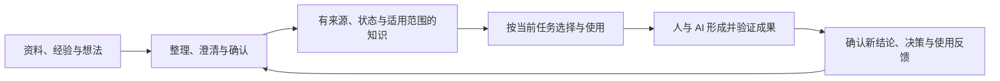

# 目标与边界

**构建面向 AI 时代的知识沉淀、消费与生产能力。**

让已有知识能够支撑人与 AI 的工作，让工作中形成的新知识和成果得到积累，并在后续使用中不断完善。原始材料、个人经验、讨论与最终成果都可能包含知识，Ratel 要支持这些知识参与完整的工作过程。

## 用户与核心任务

首先服务拥有持续项目和积累材料的个人知识工作者：研究、产品、技术、培训、写作等工作中，需要反复查找依据、形成判断并交付成果的人。团队协作是扩展方向，本稿不预先承诺多用户权限与协同编辑。

材料可以是笔记、表格、演示稿、文档、图片，也可以是讨论中的经验、假设和决定。用户不必先把整个库整理成理想结构才能开始使用。

核心任务是：“带着当前问题，找到正确材料与既有判断，形成可核查的成果，并把这次确认过的新知识留给下一次工作。”

## 知识的处理过程

- **沉淀**：把资料、经验与判断转化为后续能够使用的知识，保留依据、确认状态与适用条件。
- **消费**：让人与 AI 在具体任务中找到、理解并用上合适的知识，结合范围、版本与效力判断内容是否适用。
- **生产**：基于已有知识，通过思考、讨论和实践形成新知识与成果，留下问题澄清、方案取舍与验证中的关键判断。

加工、确认和持续更新服务于上述能力，属于支撑知识处理过程的手段。

在知识消费环节，需要帮助人与 AI 区分：内容来自哪里、是否已确认、目前是否有效、对当前任务是约束还是参考，以及不确定的部分是什么。上述信息的组织方式留待需求确认后设计，不预设一套全库强制标签或数据模型。

## 人、AI 与工具的职责

AI 可以帮助发现、整理、比较、提出候选并执行已授权操作；用户决定目标、关键取舍、确认效力与交付是否可用。工具负责实际读取、定位、计算或文件处理，并给出可检查的结果。模型流畅地解释，不等于结果已验证；用户确认一个目标，也不等于授权全部文件修改和外发。

已有检索、链接、记忆、AGENTS.md、目标与 Skill/MCP 能力可以继续服务这些环节。Skill 用于复用经过验证的方法和配置，不把安装 Skill 本身当成用户最终收益；工具和模型的实际能力边界必须可见。

## 成功判断

用真实任务比较演进前后的表现：是否减少反复寻找和解释背景，是否提高来源核查与适用判断的正确性，成果能否按验收要求使用，新任务能否复用上次确认的结论。

同时检查代价：是否制造了额外整理负担、过多确认或噪声，是否影响 Obsidian 日常使用，资源消耗与外发是否可控。文件数、向量数、工具数和生成篇幅只反映规模，不直接代表用户价值。具体指标与门槛需要选定首期场景后建立基线。

## 范围边界

本轮不承诺替代所有 Office 软件、自动理解所有视觉内容、将完整聊天自动认定为长期知识、让模型自行决定所有事实与规则，或在 Obsidian 关闭后持续执行任务。多格式支持、主动提醒、治理和产物生成都是候选能力，需要证明它们对选定任务的作用。

本地优先、来源可核查、最小必要披露、用户可控制变更与开放模型/工具继续作为约束。当前产品已交付行为仍以版本说明和使用手册为准，2.0 愿景不能倒写为现有能力。
